<div align="center">

# SHADOWSCOPE AM

### Agentic Cyber Threat Intelligence & Security Engineering Platform

**From fragmented threat feeds to connected intelligence, guided investigations and actionable detection content.**

<p>
  
  
  
  
</p>

<p>
  
  
</p>

**Collect. Normalize. Enrich. Correlate. Investigate. Hunt. Detect.**

[**Overview**](#overview) · [**Architecture**](#platform-architecture) · [**Intelligence Engines**](#intelligence-engines) · [**Agentic Architecture**](#agentic-security-architecture) · [**Live Demos**](#technical-demonstrations) · [**Technology**](#technology-stack) · [**Roadmap**](#engineering-roadmap)

</div>

---

## Overview

**ShadowScope AM** is an end-to-end Cyber Threat Intelligence engineering project designed to turn heterogeneous security data into investigation-ready intelligence. It brings together data collection, normalization, infrastructure enrichment, risk scoring, correlation, knowledge graphs, semantic retrieval, local LLM assistance and multi-format detection generation within one architecture.

The project addresses a recurring operational problem: security teams can obtain millions of indicators, yet still spend considerable time answering basic investigative questions. Where did this indicator originate? What else is associated with it? Which connections are directly evidenced? Which records deserve immediate review? How can the intelligence be translated into usable detection logic?

ShadowScope AM approaches these questions through distinct but connected processing layers. **OpenSearch** maintains structured intelligence; **Neo4j** models explicit relationships; **Qdrant** supports retrieval by semantic similarity; and **Python services** transform the resulting context into investigation workflows and detection outputs. A locally hosted LLM provides a natural-language analysis interface on top of these sources.

> **The goal is not to accumulate indicators. It is to make threat intelligence explainable, connected and operationally useful.**


---

## The Security Challenge

Modern threat intelligence is distributed across feeds, APIs, advisories, malware repositories and infrastructure reputation services. Each source may have different schemas, update cycles, confidence levels and relationships.

| Conventional workflow | ShadowScope AM approach |
|:---|:---|
| Analysts manually switch between multiple CTI feeds | Centralized collection and normalized records |
| IOC records are evaluated in isolation | Enrichment, correlation and graph-based pivoting |
| Large feeds create analyst noise | Validation, scoring and risk-based investigation queues |
| Keyword searches require known indicators | Semantic retrieval of natural-language threat descriptions |
| Investigation context must be assembled manually | Context builder, retrieval and LLM-assisted synthesis |
| CTI findings often stop at reports | Draft detection content for four security technologies |

The emphasis is on **source traceability, explicit relationships, contextual retrieval and analyst review**. The platform does not treat a shared ASN, a high vector similarity score or a generated LLM explanation as conclusive threat attribution.

---

## Platform Architecture

<p align="center">
  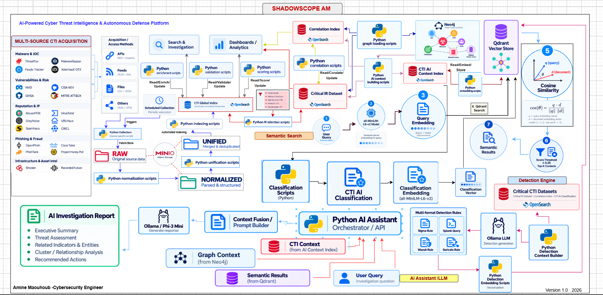
</p>

### End-to-end intelligence architecture

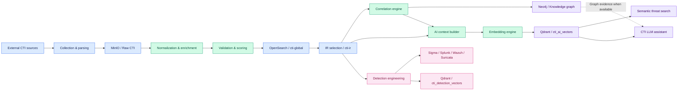

### Storage and intelligence responsibilities

| Layer | Backing technology | Role |
|:---|:---|:---|
| Raw intelligence | MinIO | Preserves original CTI payloads for traceability and reprocessing |
| Global CTI | OpenSearch `cti-global` | Searchable normalized and enriched records |
| Investigation queue | OpenSearch `cti-ir` | Prioritized threats requiring review |
| Correlation intelligence | OpenSearch `cti-correlations` | Shared attributes, member records, cluster IDs and risk metadata |
| Graph intelligence | Neo4j | Explicit entity and relationship exploration |
| AI-ready context | OpenSearch `cti-ai-context` | Structured records converted to searchable text |
| Semantic intelligence | Qdrant `cti_ai_vectors` | Normalized 384-dimensional vectors and CTI payloads |
| Detection intelligence | Qdrant `cti_detection_vectors` | Generated rule records and associated metadata |

---

## Intelligence Engines

### 01 / Global CTI Acquisition

The collection layer ingests multiple intelligence categories, including malicious IP and domain reputation, phishing URLs, malware families, vulnerabilities, exploited CVEs, campaigns and external security advisories. Python collectors handle heterogeneous formats and preserve the original records before downstream processing.

**Ingestion channels:** REST APIs, GraphQL where supported, JSON, CSV, XML, RSS/security feeds and structured threat-intelligence exchanges such as STIX/TAXII. The captured validation covers **20 collectors**, with scheduled collection configured for periodic refresh.

### 02 / Normalization, Enrichment & Risk Intelligence

The normalization pipeline maps source-specific data into a common CTI representation. Supported fields include indicator identity, type, source, timestamps, descriptions, classification, malware, vulnerabilities and associated infrastructure.

The enrichment stage adds available **DNS, RDAP/WHOIS, ASN, hosting, geographic and network-classification** context. Validation then evaluates threat-related signals and potential false-positive factors. Risk scoring converts that context into an operational priority rather than relying only on raw feed membership.

| Risk score | Severity | Investigation priority |
|:---:|:---|:---|
| 90–100 | Critical | P1 / immediate review |
| 70–89 | High | P2 / investigation |
| Below 70 | Outside the demonstrated IR threshold | Retained for broader CTI analysis |

The displayed risk levels are internal scoring outcomes and must be interpreted alongside original source evidence and validation status.

### 03 / Threat Correlation & Cluster Intelligence

The correlation engine operates on prioritized records and groups indicators sharing an identified characteristic. A correlation is created when at least **two** source entities share a qualifying value.

**Correlation dimensions:** ASN and ASN organization, country, threat type, malware family, campaign, APT group, related CVE, source and tags. Each correlation can record the shared value, members, severity, maximum/average risk and stable correlation/cluster identifiers.

### 04 / Neo4j Cyber Threat Knowledge Graph

The graph loader transforms IR and correlation intelligence into relationships that an analyst can traverse rather than read as unrelated records.

| Node | Example connections |
|:---|:---|
| `Indicator` | `ASSOCIATED_WITH_MALWARE`, `USES_ASN`, `REPORTED_BY`, `LOCATED_IN` |
| `Indicator` | `HAS_THREAT_TYPE`, `RELATED_TO_CVE`, `PART_OF_CAMPAIGN`, `ATTRIBUTED_TO` |
| `Indicator` | `HAS_CORRELATION`, `MEMBER_OF_CLUSTER` |
| `Correlation` | `BELONGS_TO_CLUSTER` |

A shared provider, country or ASN is **context for investigation**, not sufficient evidence of common attacker control. This distinction is preserved in the investigation model.

### 05 / AI Context Engineering & Vector Intelligence

Selected IR and correlation documents are converted into descriptive intelligence text. Each context can include risk, validation, malware, source, infrastructure and correlation information. The embedding engine uses **`sentence-transformers/all-MiniLM-L6-v2`** to generate normalized **384-dimensional** vectors stored in Qdrant.

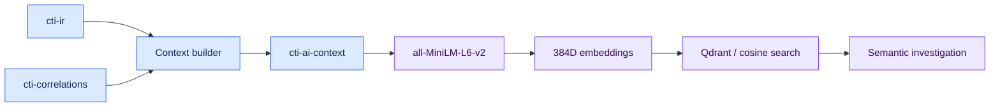

The vector store complements—not replaces—structured search and explicit Neo4j relationships. Similarity indicates relevance of text representations and should not be interpreted as probability that two threats are operationally linked.

### 06 / LLM-Assisted Investigation & Retrieval

The investigation API accepts natural-language questions, retrieves semantic context and prepares a structured response using a local LLM. The architecture also supports Neo4j graph-context retrieval, although the captured `/ask` execution encountered a graph connection failure.

A reliable investigation response needs to distinguish **exact IOC evidence**, **graph relationships**, **semantic neighbors** and **model-generated interpretation**. Maintaining that separation is a priority of the next development phase.

### 07 / Multi-Format Detection Engineering

The detection engine prepares security monitoring content from prioritized CTI indicators. Its output includes Sigma detection rules, Splunk SPL queries, Wazuh XML rules and Suricata IDS/IPS signatures, together with the origin indicator and risk metadata.

Generated rules are **draft detection artifacts**. Syntax validation, platform-specific field mapping, false-positive testing, replay tests and deployment remain separate approval steps.

---

## Agentic Security Architecture

ShadowScope AM is organized around **specialized investigation capabilities** that can be coordinated in an agentic workflow. Rather than allowing an unrestricted model to act directly on infrastructure, the architecture separates information retrieval, analysis, rule generation and human approval.

### Capability map

| Agent / capability | Responsibility | Current engineering basis |
|:---|:---|:---|
| CTI Intelligence | Collect and retrieve external threat evidence | CTI collectors, OpenSearch, enrichment |
| Threat Correlation | Discover shared threat characteristics | Correlation engine and Neo4j graphs |
| Semantic Hunting | Retrieve related intelligence by meaning | Context builder, embeddings, Qdrant, search API |
| Investigation | Assemble context and produce assessments | FastAPI `/ask`, semantic retrieval, local LLM |
| Detection Engineering | Prepare rules for operational review | Sigma, Splunk, Wazuh, Suricata generator |
| Validation & Oversight | Check evidence and approve high-impact actions | Analyst-controlled target workflow; further automation planned |

### Bounded investigation lifecycle

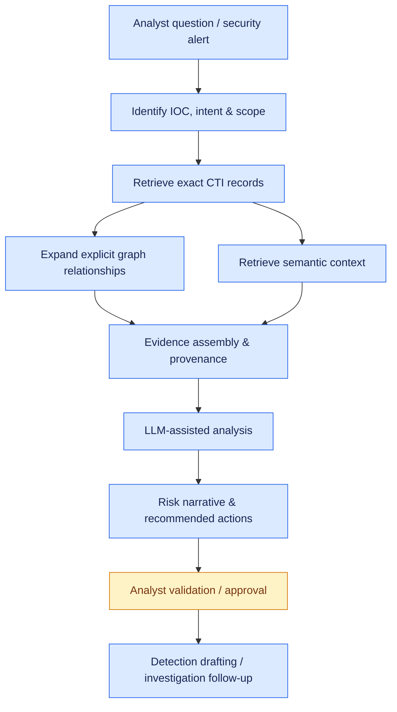

**Operational boundary:** The individual intelligence, retrieval, graph and detection components have been demonstrated. Fully autonomous multi-agent planning, cross-agent state management, safe tool authorization and end-to-end execution are **development goals**, not established production capabilities in the supplied tests.

### Why local inference?

The project uses **Ollama** with **Phi-3 Mini** as its documented local LLM configuration. Local inference provides a foundation for controlling where investigation context is processed and for developing private deployment options. Data protection still depends on infrastructure isolation, access controls, logging and the configuration of connected services.

---

## Technical Demonstrations

These eight demonstrations follow the same order as the processing pipeline. Each shows a specific implementation layer and the evidence observed during testing. Screenshot counts and results refer to those executions, not to a permanent live dataset.

| Demo | Technical focus | Evidence |
|:---|:---|:---|
| [01](#demo-01--global-cti-pipeline) | Multi-source acquisition & normalization | Collectors, MinIO, normalized CTI |
| [02](#demo-02--enrichment-validation--scoring) | Threat context & risk selection | Enrichment, validation, scoring |
| [03](#demo-03--risk-based-investigation-queue) | Investigation operations | OpenSearch IR dashboard |
| [04](#demo-04--automated-correlation--knowledge-graph) | Graph intelligence | IOC, clusters, FlowerStorm |
| [05](#demo-05--ai-contexts-embeddings--vector-intelligence) | CTI vectorization | Qdrant `cti_ai_vectors` |
| [06](#demo-06--semantic-threat-search) | Context-driven discovery | Ranked search results |
| [07](#demo-07--llm-assisted-threat-investigation) | Context retrieval & LLM answer | FastAPI response and limitations |
| [08](#demo-08--automated-detection-engineering) | Detection generation | Four rule formats |

### Demo 01 — Global CTI Pipeline

The first demonstration covers the transition from diverse external intelligence feeds to unified CTI records. The recorded collection run completed **20/20 collectors successfully**, and the raw layer contained **85 MinIO objects**.

#### 01.1 - Multi-source CTI acquisition

<p align="center">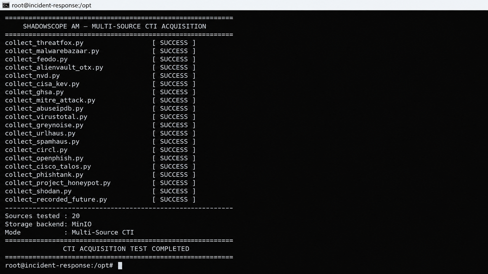</p>

The acquisition process collects vulnerability, malware, phishing, reputation and infrastructure information into the raw CTI layer. The execution is designed to run on a daily schedule, with source-specific refresh frequency depending on the configured collector.

**Observed:** `20/20 collectors successful` · `Scheduled acquisition` · `MinIO raw storage`

#### 01.2 - Raw intelligence preservation

<p align="center">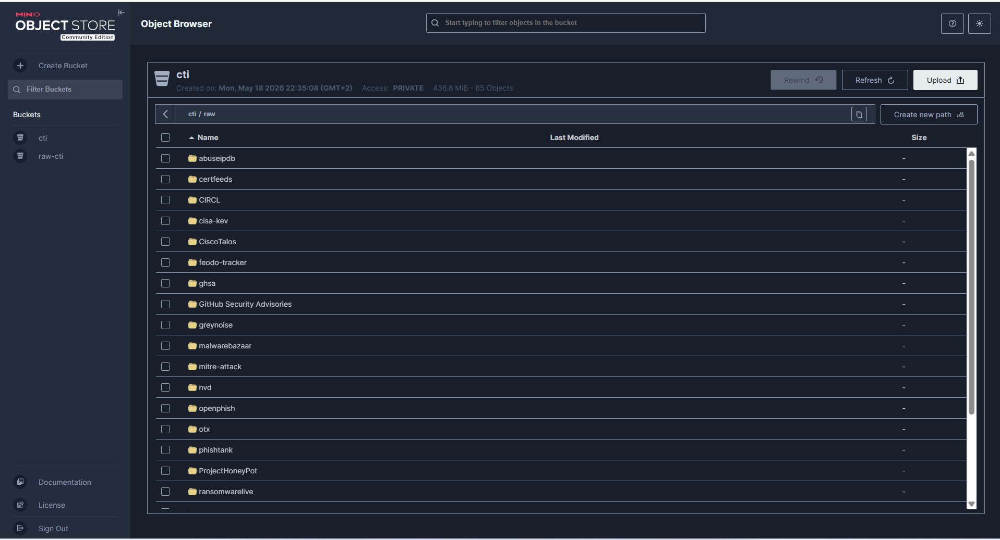</p>

Original feed outputs are retained in source-specific storage paths. The recorded snapshot shows **85 objects / 436.8 MiB**, providing a basis for provenance, debugging and reprocessing.

#### 01.3 - Source normalization

<p align="center">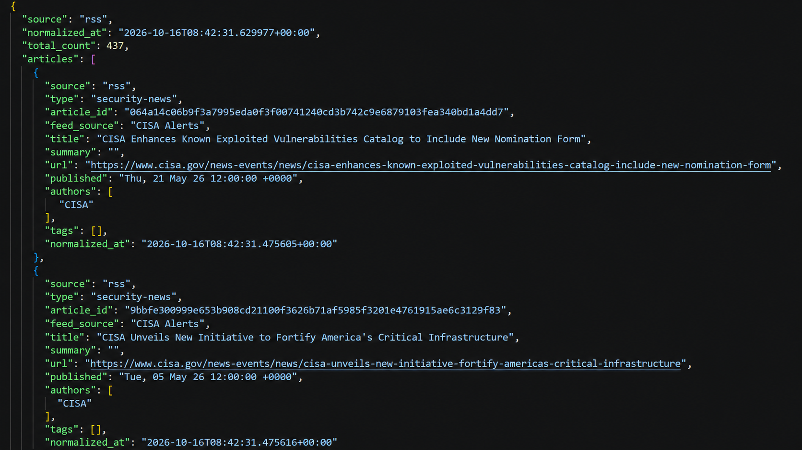</p>

The example processes **437 RSS security intelligence records**, demonstrating transformation from source-specific feed entries to structured CTI objects.

#### 01.4 - Unified CTI schema

<p align="center">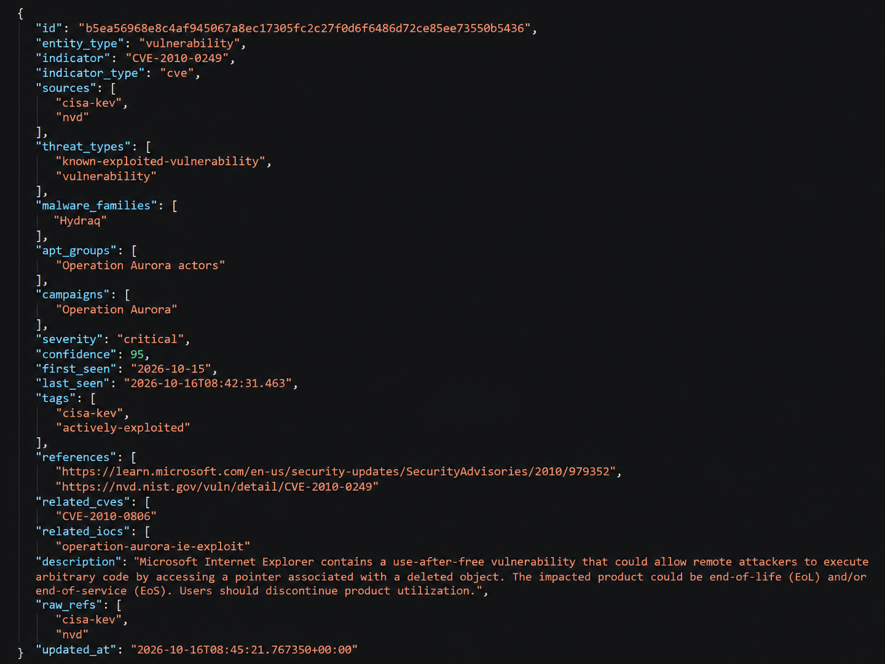</p>

The schema example references `CVE-2010-0249` with fields for identity, classification, evidence, severity and source provenance. The unified structure allows downstream search, enrichment, scoring and correlation engines to consume records consistently.

**Engineering result:** A repeatable acquisition-to-normalization path with preserved source data and a common intelligence model.

---

### Demo 02 - Enrichment, Validation & Scoring

Raw indicator values are often insufficient for investigation. This stage adds infrastructure context, evaluates possible false-positive conditions and assigns a risk-based priority.

#### 02.1 - Infrastructure enrichment

<p align="center">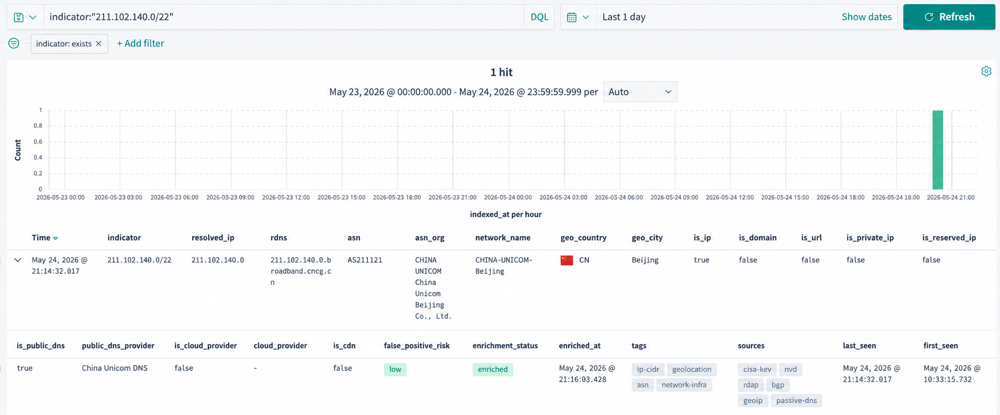</p>

Supported enrichment attributes include reverse DNS, ASN/organization, RDAP, geographic context, network owner and infrastructure classification.

#### 02.2 - Rule-based threat validation

<p align="center">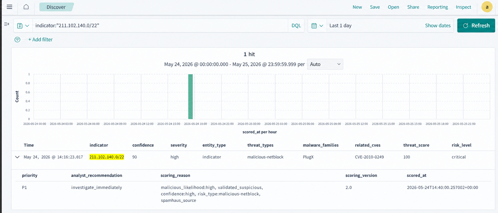</p>

The displayed `211.102.140.0/22` record received **Suspicious** status, **60% malicious likelihood** and a **40 legitimacy score** under the platform's rules. These scores are internal estimates, not independent ground truth.

#### 02.3 - Operational risk prioritization

<p align="center"></p>

The captured record references the **PlugX** malware family and **CVE-2010-0249**. Its computed result is **100/100**, **Critical**, **P1**, with the recommended action to investigate immediately.

**Engineering result:** Enriched, assessed and prioritized intelligence that can enter an analyst-facing investigation queue.

---

### Demo 03 - Risk-Based Investigation Queue

The global intelligence index is not itself an incident queue. ShadowScope AM promotes records meeting investigation criteria into **`cti-ir`**, while leaving the broader normalized intelligence in `cti-global`.

**Selection logic:** Scoring complete, suspicious/malicious status, risk **≥ 70**, P1/P2 priority, and exclusion of selected benign or high false-positive-risk infrastructure.

#### 03.1 - Investigation & response dashboard

<p align="center">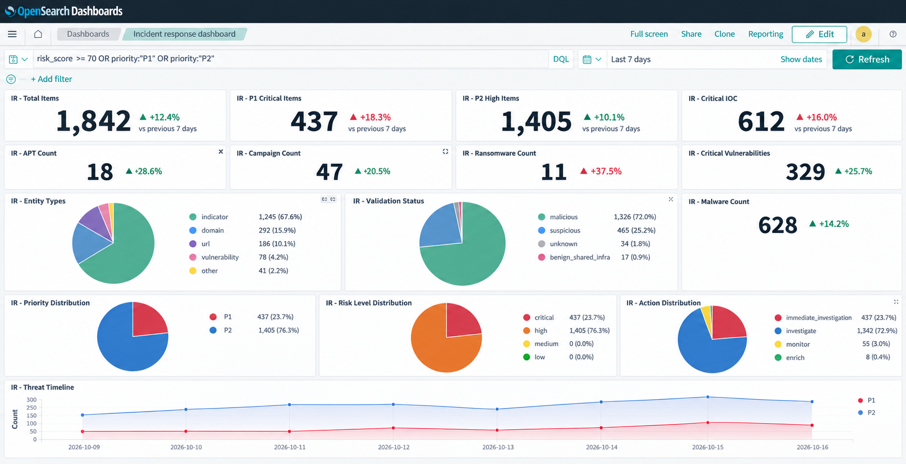</p>

The OpenSearch dashboard brings together critical indicators, validation states, malware, campaigns, vulnerabilities and investigation priorities. It provides a working surface for selecting which threat intelligence records require immediate examination.

| Risk band | Queue priority | Analyst action |
|:---:|:---|:---|
| 90–100 | P1 / Critical | Immediate review |
| 70–89 | P2 / High | Investigation |

**Engineering result:** `cti-global` → prioritized `cti-ir` investigation selection.

---

### Demo 04 - Automated Correlation & Knowledge Graph

The correlation engine groups qualifying intelligence records by shared attributes, while Neo4j models the explicit connections needed for IOC pivoting and malware-centric investigation. The following screenshots cover three complementary graph exploration scenarios.

#### 04.1 - IOC-centric investigation

**Target:** `node828765.dwservice.net`

```cypher
MATCH (i:Indicator {value: "node828765.dwservice.net"})-[r]-(n)
RETURN i, r, n;
```

<p align="center">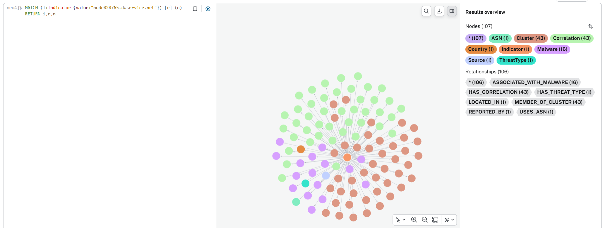</p>

| Observed graph elements | Count |
|:---|---:|
| Nodes | **107** |
| Relationships | **106** |
| Malware nodes | 16 |
| Correlation nodes | 43 |
| Cluster nodes | 43 |

The query starts with one indicator and exposes the malware, infrastructure, source, correlation and cluster nodes connected to it in the current graph.

#### 04.2 - Correlation and cluster discovery

```cypher
MATCH (cl:Cluster)<-[:BELONGS_TO_CLUSTER]-(c:Correlation)
MATCH (i:Indicator)-[:HAS_CORRELATION]->(c)
RETURN cl, c, i
LIMIT 100;
```

<p align="center">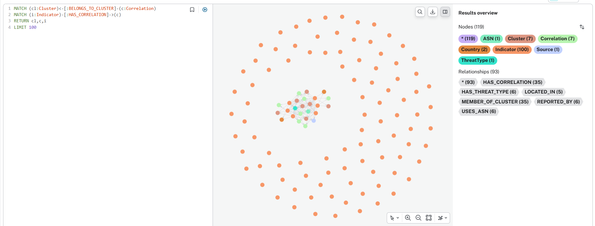</p>

The recorded graph display contains **119 nodes** and **93 relationships**, including **100 indicators, 7 correlations and 7 clusters**. It demonstrates the graph model for shared intelligence patterns; a shared property should not be taken as verified campaign membership.

#### 04.3 - FlowerStorm malware investigation

```cypher
MATCH (m:Malware {name: "FlowerStorm"})<-[r:ASSOCIATED_WITH_MALWARE]-(i:Indicator)
RETURN m, r, i;
```

<p align="center">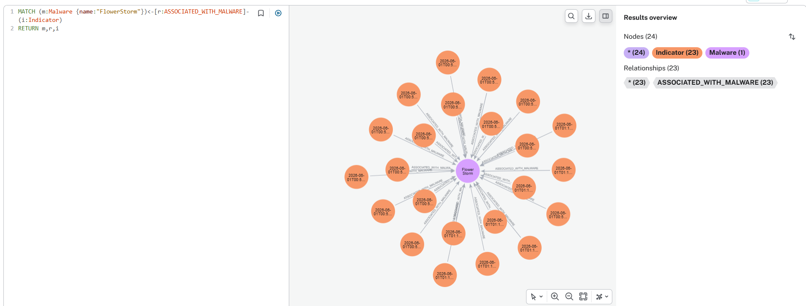</p>

**Observed:** `1 malware node` · `23 indicator nodes` · `23 associations`

#### 04.4 — Expanded FlowerStorm intelligence graph

<p align="center">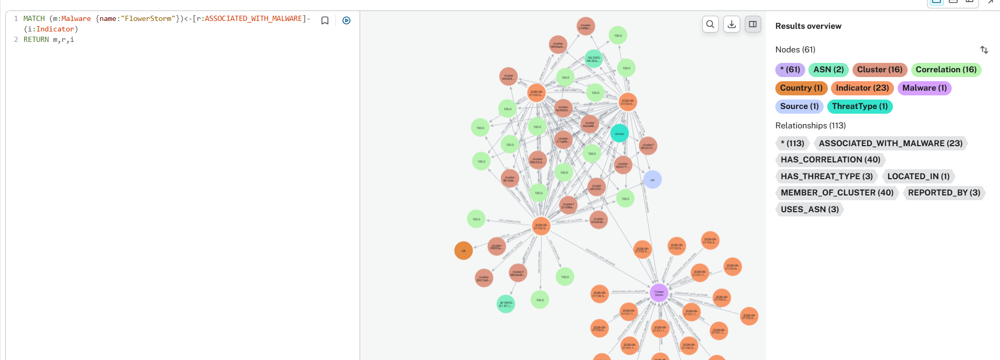</p>

The expanded view contains **61 nodes** and **113 relationships** across malware, indicators, correlations, clusters, ASN, country, source and threat type.

**Engineering result:** Explicit relationship-based pivots that enrich an investigation beyond flat IOC lists.

---

### Demo 05 - AI Contexts, Embeddings & Vector Intelligence

This demonstration documents how threat intelligence becomes searchable semantic context. The AI context builder reads prioritized indicators and correlations, assembles text summaries and stores them in `cti-ai-context`. The embedding engine then writes normalized vectors and source metadata to Qdrant.

**Configuration:** `all-MiniLM-L6-v2` · `384 dimensions` · `cosine similarity` · `cti_ai_vectors`

#### 05.1 - AI-ready vector payload

<p align="center">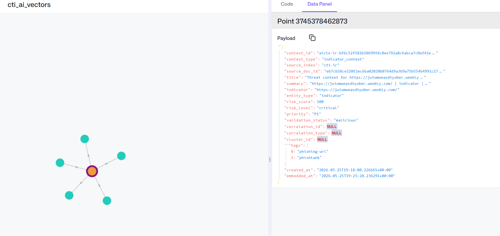</p>

The displayed vector record is an **indicator context** from `cti-ir`, with **Critical** classification, risk **100**, priority **P1**, **PhishTank** source metadata and an embedding timestamp. Its correlation and cluster identifiers are null in this particular record.

| Payload attribute | Purpose |
|:---|:---|
| `context_id` / `source_doc_id` | Trace back to the originating intelligence record |
| `summary` / `indicator` | Give the analyst a readable CTI reference |
| `risk_score` / `priority` | Preserve operational prioritization |
| `correlation_id` / `cluster_id` | Carry relationship metadata where available |
| `tags` | Retain threat-type and source classification |

**Engineering result:** Embedded intelligence contexts with operational metadata available for semantic retrieval.

---

### Demo 06 - Semantic Threat Search

The Semantic Search interface accepts an analyst's question and returns vector-ranked CTI contexts. This demonstration focuses on **infrastructure correlation** rather than an exact-match IOC lookup.

**Search query:**

```text
Find high-risk indicators sharing ASN infrastructure or threat correlation clusters.
```

**Parameters:** `Top K = 10` · `Minimum similarity = 0.30`

#### 06.1 - Query and leading results

<p align="center">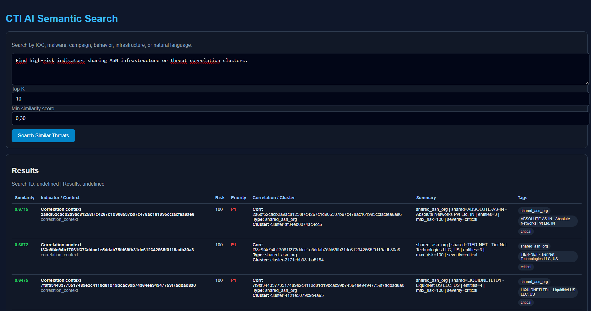</p>

The highest returned context has similarity **0.6715**. The visible results are primarily `correlation_context` records of type `shared_asn_org`, with critical-risk source metadata, **P1** priorities, correlation IDs and cluster IDs.

#### 06.2 - Additional ranked contexts

<p align="center">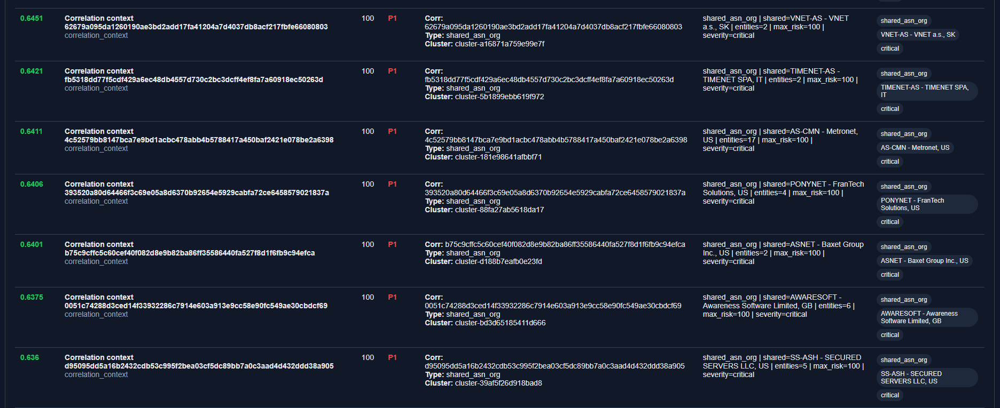</p>

Further results include ASN organization contexts associated with **VNET**, **TIMENET**, **Metronet**, **FranTech Solutions**, **Baxet Group**, **Awarenes Software** and **SECURED SERVERS**. Scores across the displayed top ten range from approximately **0.6360 to 0.6715**.

**Interpretation:** The search retrieves *textually relevant correlation intelligence*. The risk values come from stored CTI context, while cosine similarity ranks contextual relevance; neither alone verifies an operational link between returned organizations.

#### Video walkthroughs

These demonstrations are reserved for recorded executions. Links will be added after the videos are published.

| Scenario | Planned investigation | Recording |
|:---|:---|:---|
| 01 / Phishing | `Find high-risk phishing URLs reported by PhishTank.` | *Coming soon* |
| 02 / Malware | `Find threat intelligence related to FlowerStorm malware and associated indicators.` | *Coming soon* |
| 03 / Infrastructure | `Find high-risk indicators sharing ASN infrastructure or threat correlation clusters.` | *Coming soon* |

**Engineering result:** Natural-language threat hunting over vectorized indicator and correlation contexts.

---

### Demo 07 - LLM-Assisted Threat Investigation

The **CTI LLM Assistant** exposes an investigation API and retrieves contextual intelligence to support structured security answers. The demonstration documents the complete API interaction and its limitations, rather than treating generated text as verified attribution.

#### 07.1 - Investigation request

```http
POST /ask
Content-Type: application/json
```

```json
{
  "question": "What is the risk associated with node828765.dwservice.net?",
  "top_k": 3
}
```

<p align="center">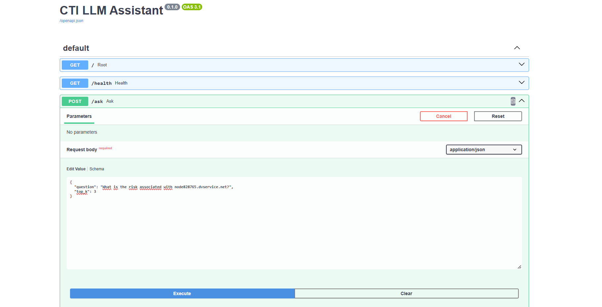</p>

#### 07.2 - Semantic retrieval results

<p align="center">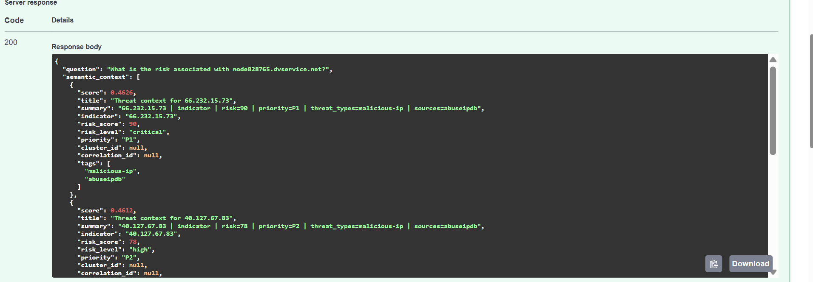</p>

The API returned **HTTP 200** and three semantic neighbor records:

| Retrieved IP | Similarity | CTI risk | Priority | Source |
|:---|---:|---:|:---|:---|
| `66.232.15.73` | 0.4626 | 90 | P1 | AbuseIPDB |
| `40.127.67.83` | 0.4612 | 78 | P2 | AbuseIPDB |
| `31.14.32.7` | 0.4588 | 90 | P1 | AbuseIPDB |

These were **semantic search results**, not confirmed indicators associated with the original domain.

#### 07.3 - Graph retrieval diagnostics

<p align="center">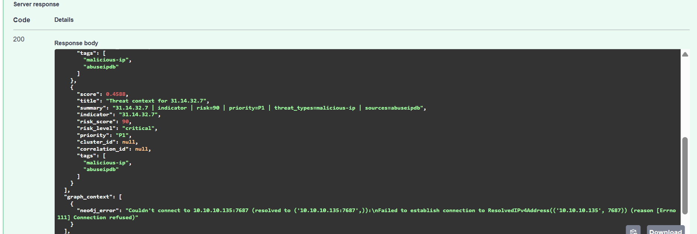</p>

In this execution, the graph retrieval service could not connect to Neo4j. Consequently, **no verified Neo4j evidence** was included in the retrieved context for the API response.

#### 07.4 - Generated investigation assessment

<p align="center">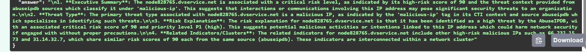</p>

The LLM returned a structured narrative with an executive summary, threat classification, risk explanation and related-indicator discussion. Some inferred associations were not supported by exact IOC matches or graph evidence in this test. **Analyst verification is therefore mandatory** before treating the output as an investigation conclusion.

| Demonstrated function | Status |
|:---|:---|
| FastAPI `/ask` request/response | Observed working |
| Qdrant context retrieval | Observed working |
| Natural-language LLM synthesis | Observed |
| Neo4j enrichment in this API test | Connection failed |
| Evidence-grounded domain attribution | Not established |
| Autonomous multi-agent execution | Not validated by this test |

**Engineering result:** An integrated semantic-retrieval and LLM-response workflow, with a clear next milestone for exact-match grounding and resilient graph enrichment.

---

### Demo 08 - Automated Detection Engineering

The final demonstration connects high-priority CTI indicators with generated detection content. One source intelligence record can result in **four detection formats**, preserved with risk metadata and a generated status for analyst review.

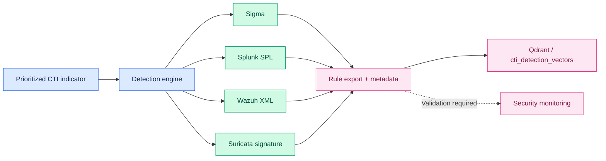

#### 08.1 - Multi-format rule generation and storage

<p align="center">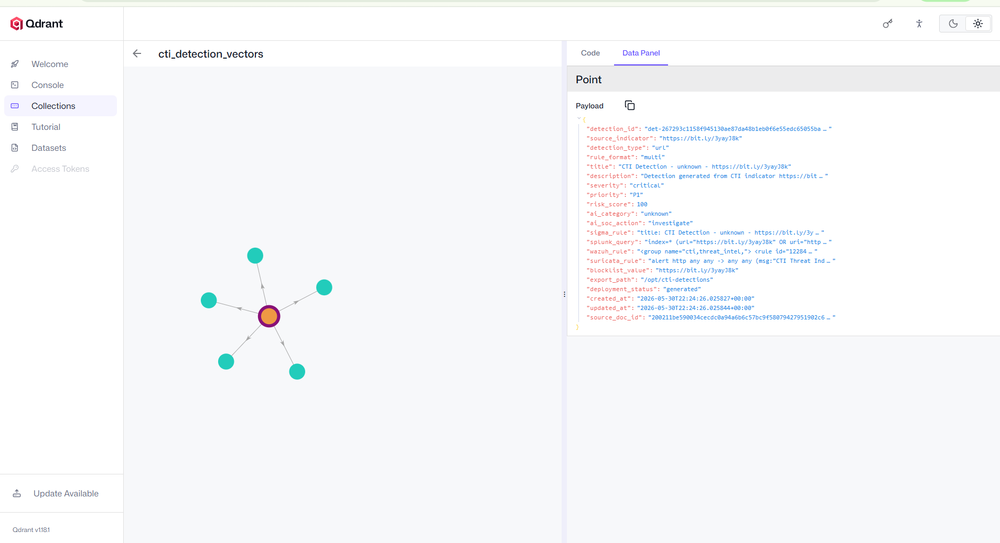</p>

The screenshot shows a generated URL detection record in `cti_detection_vectors` with **risk score 100**, **Critical** severity, **P1**, SOC action `investigate` and deployment status `generated`.

| Output | Record field | Intended environment |
|:---|:---|:---|
| Sigma | `sigma_rule` | Portable security analytics / SIEM translation |
| Splunk | `splunk_query` | Search Processing Language |
| Wazuh | `wazuh_rule` | XML-based security event detection |
| Suricata | `suricata_rule` | IDS/IPS network signature |

The record also retains its detection identifier, original indicator, description, timestamps and export path. Generation and storage are validated by the screenshot; **rule correctness, false-positive rates and live deployment are not established**.

**Engineering result:** A multi-format detection-content pipeline linked to prioritized threat intelligence.

---

## Operational Use Cases

| Security role | Starting point | What ShadowScope AM provides |
|:---|:---|:---|
| **SOC Analyst** | Suspicious alert or IOC | Context, risk priority, related entities and investigation leads |
| **CTI Analyst** | Feed intelligence or malware family | Structured records, source context, correlations and graph pivots |
| **Threat Hunter** | Behavior or infrastructure hypothesis | Semantic discovery and related CTI contexts |
| **Incident Responder** | Domain, IP or malicious activity | Risk-based investigation queue and relationship exploration |
| **Detection Engineer** | Confirmed or reviewed threat indicator | Draft Sigma, SPL, Wazuh and Suricata outputs |
| **Security Architect** | Distributed intelligence stack | Clear boundaries between source data, graph, search and inference |

### Example investigation path

An analyst begins with `node828765.dwservice.net`, checks the exact IOC record, examines its Neo4j neighbors, reviews related high-risk contexts through Qdrant and requests an investigation summary. If sufficient evidence is available, the analyst may then prepare candidate detection content and validate it against actual log or network telemetry.

The value comes from **moving between these investigation modes without losing the originating CTI context**.

---

## Technology Stack

| Domain | Tools and components |
|:---|:---|
| CTI acquisition | Python, REST/GraphQL APIs, RSS and structured feeds |
| Raw intelligence | MinIO |
| Normalization and analytics | Python, OpenSearch |
| Enrichment | DNS, RDAP/WHOIS, ASN, geographic and infrastructure context |
| Correlation | Python correlation engine, OpenSearch |
| Knowledge Graph | Neo4j, Cypher |
| AI context preparation | Python `ai_context_builder.py` |
| Text embeddings | Sentence Transformers / `all-MiniLM-L6-v2` |
| Vector search | Qdrant / cosine similarity |
| LLM inference | Ollama, Phi-3 Mini (documented local setup) |
| APIs and interfaces | FastAPI, HTML / JavaScript, Swagger/OpenAPI |
| Detection | Sigma, Splunk SPL, Wazuh, Suricata |

### Main source modules

```text
Source_Code/
├── 01_Data_Collection/
├── 02_Data_Normalization/
├── 03_Indexing_Search/
├── 04_Threat_Enrichment/
├── 05_Correlation_Knowledge_Graph/
│   ├── correlation_engine.py
│   └── graph_loader.py
├── 06_AI_Assistant/
│   ├── ai_context_builder.py
│   ├── embedding_engine.py
│   ├── semantic_search_api.py
│   ├── llm_assistant_api.py
│   ├── ai_classification_engine.py
│   └── detection_engine.py
└── 07_Documentation/
```

The repository structure mirrors the intelligence lifecycle so that individual components can be tested and improved independently. Deployment-specific settings, runtime state, credentials, datasets and generated detections should remain outside public source control unless deliberately sanitized.

---

## Engineering Validation & Current Boundaries

The following distinctions are deliberate: showing a feature in a screenshot validates that specific result, not the safety or reliability of an entire operational deployment.

| Area | Demonstrated | Next validation step |
|:---|:---|:---|
| Feed collection | 20 collector executions | Fault tolerance, feed freshness and scheduled-run metrics |
| Processing and scoring | Enrichment, validation and P1/P2 outcomes | Calibration, ground truth and false-positive evaluation |
| Correlation and graph | Connected IOC/malware/correlation views | Evidence weighting, temporal relations and provenance checks |
| Semantic search | Ranked indicator/correlation retrieval | Relevance evaluation, hybrid search and result explanations |
| CTI LLM assistant | API response and context retrieval | Exact IOC grounding, restored graph connectivity and citations |
| Agentic orchestration | Specialized building blocks and design | Tool policy, multi-agent execution traces and approval checkpoints |
| Detection engineering | Four formats generated and stored | Syntax tests, replay, rule QA and controlled deployment |

**No autonomous blocking or containment is demonstrated in these materials.** High-impact actions belong behind explicit permissions and analyst approval.

---

## Engineering Roadmap

| Priority | Workstream | Planned improvement |
|:---|:---|:---|
| **P0** | Reliable investigation | Restore Neo4j retrieval; exact IOC lookup before semantic fallback; evidence citations |
| **P0** | Public-release security | Externalize secrets, rotate exposed credentials, sanitize captures and history |
| **P1** | Detection quality | Rule syntax validation, platform field mappings, test-event replay and false-positive checks |
| **P1** | Search quality | Hybrid exact/lexical/vector search, reranking and relevance evaluation |
| **P1** | CTI data quality | Incremental updates, source reliability, entity resolution and temporal intelligence |
| **P2** | Agentic workflows | Agent-specific tool permissions, bounded planning, audit trails and approval gates |
| **P2** | Detection lifecycle | Versioning, coverage reporting, feedback loop and controlled deployment |
| **P2** | Operations | Monitoring, failure recovery, reproducible deployment and performance measurements |

The long-term direction is **investigation-driven security automation**: using connected intelligence to accelerate analysis and detection while preserving evidence provenance and human control.

---

## Security & Responsible Use

ShadowScope AM is a security research and engineering platform. CTI feeds may contain malicious domains, URLs and sensitive source material. Do not automatically visit or execute retrieved indicators. Generated detection rules should be reviewed against the target environment before use.

Before making the repository public:

- Remove hard-coded passwords, tokens, keys and private service configuration from code and commit history; **rotate any secrets previously exposed**.
- Redact internal addresses and personal information from screenshots without changing the documented image filenames.
- Keep `.env`, credentials, runtime state, raw datasets and generated sensitive intelligence out of Git.
- Avoid presenting untested LLM relationships as verified CTI findings or generated rules as deployed detections.
- Review third-party feed licensing, redistribution restrictions and attribution requirements.

The project follows an **analyst-in-the-loop** approach for investigation conclusions and any high-impact security response.

---

## Project Direction

ShadowScope AM is built around one principle: **the value of threat intelligence is determined by what an analyst can understand and do with it**.

A feed entry becomes useful when its provenance is preserved. It becomes more useful when it is enriched and prioritized. Its investigative value increases when related records can be traversed, retrieved semantically and examined in context. That intelligence becomes operationally meaningful when it can inform a detection rule, a threat hunt or a defensible security decision.

This project connects those stages in one engineering environment. It demonstrates the progression from **multi-source CTI acquisition** to **risk-based investigation**, **graph correlation**, **vector intelligence**, **LLM-assisted context interpretation** and **multi-format detection generation**.

The work is continuing toward stronger grounding, resilient graph integration, measurable retrieval quality and validated detection workflows. The ambition is not unrestricted autonomous defense; it is a security platform in which advanced automation makes human investigation faster, more consistent and better informed.

### Conclusion

> **From raw indicators to connected intelligence. From connected intelligence to investigation. From investigation to detection.**
>
> **ShadowScope AM is an engineering foundation for intelligence-driven cyber defense: built to make threat data searchable, explainable and actionable while keeping security decisions accountable.**

---

<div align="center">

### SHADOWSCOPE AM

**Cyber Threat Intelligence × Knowledge Graphs × Semantic Search × Security Automation**

**Designed and developed by Amine Maouhoub**  
*Cybersecurity Engineer · M2 Cybersecurity Manager*

**Global Intelligence. Connected Threats. Contextual Investigation. Proactive Defense.**

</div>
