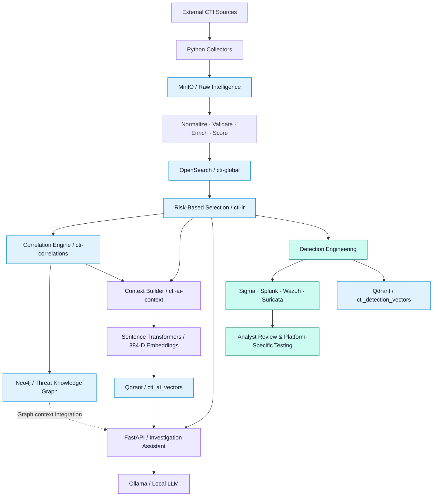
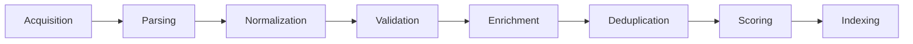
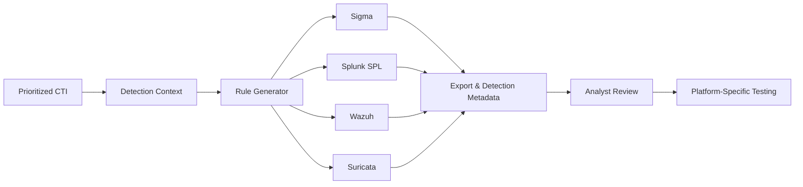

<div align="center">

# SHADOWSCOPE AM

### Cyber Threat Intelligence · Knowledge Graphs · Semantic Threat Search · AI-Assisted Investigation · Detection Engineering

**An intelligence-driven security platform connecting external threat data to investigation and detection workflows.**

<p>
  
  
  
  
</p>
<p>
  
  
  
</p>

**Collect. Enrich. Correlate. Investigate. Detect.**

[Overview](#overview) · [Architecture](#platform-architecture) · [Capabilities](#engineering-capabilities) · [Demonstrations](#technical-demonstrations) · [Validation](#validation-status) · [Roadmap](#roadmap) · [Conclusion](#conclusion)

</div>

---

## Overview

**ShadowScope AM** is a cybersecurity engineering project built to turn fragmented cyber threat intelligence (CTI) into connected, searchable, and operationally useful security context. It brings together multi-source collection, normalized threat records, contextual enrichment, risk-based prioritization, graph relationships, vector retrieval, local language-model assistance, and detection-rule generation.

The engineering problem is straightforward: security teams rarely lack indicators. They lack the time and context to connect those indicators, assess relevance, investigate related activity, and translate findings into useful monitoring logic.

ShadowScope AM addresses that gap through one integrated intelligence workflow:

> **External CTI → Unified Data → Enrichment & Risk Scoring → Threat Correlation → Graph & Vector Intelligence → Investigation → Detection Engineering**

The project is under active development. The demonstrations below document the results observed in specific tests and explicitly distinguish working components from planned or incompletely validated integrations.

### At a glance

| Engineering milestone | Documented result |
|:--|:--|
| CTI acquisition | **20/20 collectors successful** in the recorded execution |
| Raw intelligence | **85 objects / ~436.8 MiB** stored in MinIO in the captured snapshot |
| Investigation prioritization | Dedicated `cti-ir` queue, selected from scored CTI records |
| Threat relationships | Neo4j graph exploration of indicators, malware and clusters |
| Semantic intelligence | **384-dimensional** normalized embeddings in Qdrant |
| Search | Natural-language semantic retrieval over CTI and correlation contexts |
| Investigation assistant | FastAPI endpoint, semantic retrieval and local LLM response observed |
| Detection engineering | Generated content for **Sigma, Splunk SPL, Wazuh and Suricata** |
| Technical walkthroughs | **8 demonstrations**, with screenshots and validation notes |

> **Measurement note:** Counts, scores and search results reflect recorded demonstration snapshots. They are not live platform-wide metrics or independently benchmarked performance claims.

---

## Platform architecture

<p align="center">
  
</p>



### Architecture layers

| Layer | Technology | Role |
|:--|:--|:--|
| Acquisition | Python, REST/GraphQL, feeds, JSON/CSV/XML, STIX/TAXII | Collect external intelligence |
| Raw storage | MinIO | Preserve source payloads and provenance |
| CTI processing | Python | Parse, normalize, validate, enrich and score records |
| Search and analytics | OpenSearch | Index CTI, prioritized cases, correlations and generated contexts |
| Knowledge graph | Neo4j | Represent explicit threat-entity relationships |
| Vector intelligence | Sentence Transformers, Qdrant | Generate embeddings and retrieve similar CTI descriptions |
| Investigation interface | FastAPI | Accept analyst questions and coordinate context retrieval |
| Language-model runtime | Ollama, Phi-3 Mini | Generate investigation-oriented text from retrieved context |
| Detection engineering | Python, Sigma, Splunk, Wazuh, Suricata | Prepare multi-format detection content |

### Principal data stores

| Store / index | Purpose |
|:--|:--|
| MinIO `cti/raw/` | Original provider payloads |
| OpenSearch `cti-global` | Unified global CTI records |
| OpenSearch `cti-ir` | Prioritized investigation candidates |
| OpenSearch `cti-correlations` | Correlation records and cluster metadata |
| OpenSearch `cti-ai-context` | Natural-language security contexts and source references |
| Qdrant `cti_ai_vectors` | Embedded CTI and correlation contexts |
| Qdrant `cti_detection_vectors` | Generated detection records and associated metadata |
| Neo4j | Indicators, malware, infrastructure and relationship graph |

---

## Engineering capabilities

### 01 / Multi-source intelligence acquisition

The collector layer ingests intelligence across vulnerabilities, malicious infrastructure, malware, phishing, threat actors, campaigns, reputation sources and security advisories. Supported inputs include REST APIs, GraphQL, JSON, CSV, XML, feeds and structured STIX/TAXII exchange where applicable.

Collection runs on a daily schedule in the demonstrated configuration. Raw records are retained in MinIO for traceability and reprocessing.

### 02 / Standardized CTI processing

The processing pipeline handles inconsistent provider schemas, source metadata, indicator types, timestamps, confidence values and contextual fields.



The unified record model can include indicator values, source provenance, threat types, malware, APT/campaign references, related CVEs, contextual description, confidence, risk, timestamps, tags and raw-source references. Available fields vary by entity and provider.

### 03 / Enrichment, validation and risk prioritization

Enrichment introduces DNS, reverse DNS, RDAP, ASN/network ownership, geography, cloud/CDN identification and false-positive context where available. A rule-based validation stage derives an explainable status and supporting reasons. Risk scoring then turns selected CTI signals into analyst priorities.

**Investigation selection rules used in the demonstrated pipeline:**

- The record has completed scoring and has a `malicious` or `suspicious` validation status.
- Its risk score is **70 or higher** and its priority is **P1** or **P2**.
- Benign shared infrastructure and high false-positive-risk records are excluded by the selection policy.
- Selected entities enter `cti-ir` while remaining available in the global index.

| Score | Investigation tier | Suggested handling |
|:--|:--|:--|
| 90–100 | Critical | Immediate investigation |
| 70–89 | High | Analyst investigation |

These values are outputs of the project scoring logic. They should not be interpreted as calibrated probabilities of maliciousness.

### 04 / Correlation and graph intelligence

The correlation engine groups prioritized records by shared properties, including ASN, network organization, country, malware family, threat type, campaign, APT group, CVE, source and tags. Correlation records are stored in `cti-correlations` and represented in Neo4j alongside related entities.

Graph modeling supports IOC pivoting, malware-centric investigations, cluster exploration, infrastructure mapping and relationship discovery. A shared feature indicates a correlation to investigate—not confirmed campaign membership or threat-actor attribution.

### 05 / Semantic threat intelligence

The context builder converts records from `cti-ir` and `cti-correlations` into source-linked textual descriptions in `cti-ai-context`. The embedding engine uses `sentence-transformers/all-MiniLM-L6-v2` and stores **384-dimensional, normalized vectors** in Qdrant (`cti_ai_vectors`) with cosine similarity.

This allows an analyst to search for related threat descriptions by meaning, without knowing the exact IOC. Similarity scores measure retrieval relevance; they do not independently establish malicious behavior or operational relationships.

### 06 / Local LLM and investigation orchestration

The current assistant combines FastAPI, Qdrant, OpenSearch context and locally hosted LLM inference. Neo4j relationship retrieval is part of the integration architecture; the recorded LLM test encountered a graph-connection failure, detailed in Demo 07.

The intended agentic architecture separates CTI retrieval, correlation, semantic hunting, investigation and detection responsibilities. Fully autonomous multi-agent operations are a development direction rather than a capability established by the recorded test.

### 07 / Detection engineering

Prioritized intelligence can be transformed into draft content for four detection ecosystems: Sigma, Splunk SPL, Wazuh and Suricata. Generated rules are exported and stored with metadata, including the originating indicator, risk score, severity, priority and deployment status.

**Generation is not deployment.** Target-platform syntax, log-field mapping, detection quality, false-positive behavior and operational approval require separate verification.

---

## Technical demonstrations

The following walkthroughs are organized in the same order as the processing pipeline. Each image reference is preserved from the original documentation.

### Demo 01 — Global CTI pipeline

**Scope:** acquisition, raw-object storage, normalization and unified intelligence representation.

#### Multi-source collection

<p align="center"></p>

**Recorded result:** `20/20 collectors successful` · `Daily scheduled acquisition` · `MinIO raw storage`.

#### Raw intelligence storage

<p align="center"></p>

The snapshot shows **85 stored objects** totaling approximately **436.8 MiB**, organized by source under `cti/raw/`.

#### Source normalization

<p align="center"></p>

A security-news RSS example produced **437 normalized records** with structured attributes used by downstream services.

#### Unified CTI schema

<p align="center"></p>

The illustrated **CVE-2010-0249** record consolidates context from sources including CISA KEV and NVD while retaining references, severity, confidence, threat associations and provenance.

**Outcome:** independent source formats are converted into a common intelligence model while the original evidence remains traceable.

---

### Demo 02 — Enrichment, validation and risk scoring

**Scope:** convert a normalized CTI record into explainable, prioritized threat context.

#### Network and infrastructure enrichment

<p align="center"></p>

The enriched OpenSearch record includes network and infrastructure attributes such as ASN/RDAP information, reverse DNS, cloud/CDN context, network classification and potential false-positive conditions.

#### Rule-based threat validation

<p align="center"></p>

For `211.102.140.0/22`, the recorded output was **Suspicious**, with a **60% malicious-likelihood estimate** and a **legitimacy score of 40** under the engine's heuristic assessment.

#### Risk scoring and analyst priority

<p align="center"></p>

The same network record received a **100/100 threat score**, **Critical** classification and **P1** priority; the record included associations with PlugX and CVE-2010-0249.

**Outcome:** threat context, validation reasoning and analyst prioritization are recorded together. Scores should be corroborated with source evidence before operational action.

---

### Demo 03 — Risk-based investigation queue

**Scope:** promote selected high-risk CTI records from `cti-global` into `cti-ir`.

<p align="center"></p>

The investigation dashboard summarizes critical/P1 and high/P2 intelligence, validation status, related malware and vulnerability context, threat actors, campaigns, ransomware-related intelligence, risk distribution and recommended investigation actions.

Selected records include metadata such as `ir_selected`, `ir_selected_at`, `ir_status`, `ir_case_priority`, `ir_action` and `ir_index_version`.

**Outcome:** a focused investigation layer separates prioritized records from the full intelligence repository, helping analysts concentrate on actionable candidates.

---

### Demo 04 — Automated correlation and Neo4j knowledge graph

**Scope:** pivot between IOCs, malware, correlation records and clusters using explicit graph relationships.

#### Investigation A / IOC-centric relationship discovery

**Target:** `node828765.dwservice.net`

```cypher
MATCH (i:Indicator {value: "node828765.dwservice.net"})-[r]-(n)
RETURN i, r, n;
```

<p align="center"></p>

| Observed graph measure | Count |
|:--|--:|
| Nodes / relationships | 107 / 106 |
| Indicator / malware entities | 1 / 16 |
| Correlation / cluster entities | 43 / 43 |
| ASN / country / source / threat type | 1 each |

The result demonstrates how a single IOC can expose malware, source, infrastructure and correlation context for further investigation.

#### Investigation B / Correlation clusters

```cypher
MATCH (cl:Cluster)<-[:BELONGS_TO_CLUSTER]-(c:Correlation)
MATCH (i:Indicator)-[:HAS_CORRELATION]->(c)
RETURN cl, c, i
LIMIT 100;
```

<p align="center"></p>

**Observed graph:** `119 nodes` · `93 relationships` · `100 indicators` · `7 correlations` · `7 clusters` · `2 countries`.

Cluster membership represents shared characteristics. The result does not, on its own, establish common adversary control.

#### Investigation C / FlowerStorm malware associations

```cypher
MATCH (m:Malware {name: "FlowerStorm"})<-[r:ASSOCIATED_WITH_MALWARE]-(i:Indicator)
RETURN m, r, i;
```

<p align="center"></p>

**Direct relationships:** `1 malware entity` · `23 associated indicators` · `24 nodes` · `23 relationships`.

<p align="center"></p>

**Expanded graph:** `61 nodes` · `113 relationships` · `23 indicators` · `16 correlations` · `16 clusters` · `2 ASNs`.

**Outcome:** the Neo4j layer supports multiple investigation entry points: individual indicators, shared infrastructure/correlation clusters and known malware families.

---

### Demo 05 — Context engineering and vector intelligence

**Scope:** convert structured CTI and correlation records into retrievable semantic representations.

#### AI-ready CTI context generation

`06_AI_Assistant/ai_context_builder.py` builds source-linked descriptions from `cti-ir` and `cti-correlations` and indexes them in `cti-ai-context`.

An illustrative input record:

```json
{
  "indicator": "suspicious.example",
  "entity_type": "indicator",
  "risk_score": 95,
  "risk_level": "critical",
  "priority": "P1",
  "validation_status": "malicious",
  "threat_types": ["phishing"],
  "sources": ["threat-intelligence-feed"]
}
```

Its text context includes the indicator, risk, priority, validation, threat type and provenance. Where present, it also incorporates malware, campaigns, vulnerabilities, infrastructure and correlation data.

The stored context retains fields such as `context_id`, `context_type`, `source_index`, `source_doc_id`, `text`, `summary`, `risk_score`, `priority` and `embedding_status`.

#### Embedding generation and Qdrant storage

`06_AI_Assistant/embedding_engine.py` uses `sentence-transformers/all-MiniLM-L6-v2` with normalized **384-dimensional vectors** and **cosine similarity**.

<p align="center"></p>

The captured Qdrant point is an `indicator_context` sourced from `cti-ir`, representing a phishing URL classified **Critical**, scored **100**, prioritized **P1**, and tagged with `phishing-url` and `phishtank`. Its payload keeps the original CTI source references and processing metadata.

**Outcome:** contextualized CTI becomes searchable in a vector space while retaining traceability to structured intelligence. This screenshot validates vector storage; retrieval performance is assessed separately in Demo 06.

---

### Demo 06 — Natural-language semantic threat search

**Scope:** retrieve relevant threat and correlation contexts by semantic similarity instead of relying solely on exact indicators.

**Recorded search:**

```text
Find high-risk indicators sharing ASN infrastructure or threat correlation clusters.
```

| Parameter | Value |
|:--|:--|
| Top K | 10 |
| Minimum similarity | 0.30 |
| Query method | Natural-language embedding + Qdrant cosine similarity |

#### Search input and top results

<p align="center"></p>

The results are primarily `correlation_context` records related to `shared_asn_org`, with observed similarity scores approximately **0.64–0.67**, **Critical** severity, **100** risk scores and **P1** priorities.

#### Extended context retrieval

<p align="center"></p>

Retrieved context includes ASN-linked records mentioning VNET a.s., TIMENET SPA, Metronet, FranTech Solutions, Baxet Group, Awarenes Software Limited and SECURED SERVERS LLC, among others. These are data references from retrieved intelligence; appearance in a correlation result is not an accusation against an organization.

#### Additional video scenarios

The following recordings are planned; no video links are included until they are published.

1. **Phishing search:** `Find high-risk phishing URLs reported by PhishTank.`
2. **Malware search:** `Find threat intelligence related to FlowerStorm malware and associated indicators.`
3. **Infrastructure search:** `Find high-risk indicators sharing ASN infrastructure or threat correlation clusters.`

**Outcome:** natural-language retrieval returned relevant, prioritized CTI correlation descriptions. A semantic match is a search result, not proof of causal or operational linkage.

---

### Demo 07 — CTI LLM assistant and threat investigation

**Scope:** submit an investigation question, retrieve related intelligence, and obtain a structured security assessment from a locally hosted LLM.

#### Investigation request

**Endpoint:** `POST /ask`

```json
{
  "question": "What is the risk associated with node828765.dwservice.net?",
  "top_k": 3
}
```

<p align="center"></p>

#### Qdrant context retrieval

<p align="center"></p>

The API returned **HTTP 200** and three semantic contexts:

| Retrieved IOC | Similarity | Risk score | Priority | Source |
|:--|--:|--:|:--|:--|
| `66.232.15.73` | 0.4626 | 90 | P1 | AbuseIPDB |
| `40.127.67.83` | 0.4612 | 78 | P2 | AbuseIPDB |
| `31.14.32.7` | 0.4588 | 90 | P1 | AbuseIPDB |

The retrieval step functioned, but those IP records did **not** independently establish a relationship with the investigated domain.

#### Neo4j relationship retrieval

<p align="center"></p>

The graph-retrieval component reported a connection failure. Accordingly, this execution **does not validate graph-enriched investigation** even though the overall API returned an HTTP success response.

#### Generated assessment

<p align="center"></p>

The assistant generated an analyst-readable report with an executive summary, threat classification, risk explanation and related-intelligence discussion. Some associations expressed in the narrative were not corroborated by exact IOC matching or graph evidence.

**What this test establishes:** successful API execution, Qdrant retrieval and a generated LLM assessment.

**What remains open:** Neo4j connectivity, exact-indicator verification, evidence-grounded citations, reliable graph context fusion and autonomous multi-agent investigation.

**Outcome:** the assistant demonstrates the investigation interface and synthesis path, with important evidence-quality limits clearly identified.

---

### Demo 08 — Automated detection engineering

**Scope:** generate and store detection content from high-priority CTI indicators.



<p align="center"></p>

**Observed record:** `cti_detection_vectors` · `URL indicator` · `Risk 100/100` · `Critical` · `P1` · `Status: Generated` · `Export: /opt/cti-detections`.

| Output | Stored field | Intended use |
|:--|:--|:--|
| Sigma | `sigma_rule` | Portable SIEM detection logic |
| Splunk | `splunk_query` | SPL hunting and monitoring searches |
| Wazuh | `wazuh_rule` | XML-based security event rules |
| Suricata | `suricata_rule` | Network IDS/IPS signatures |

The detection record also retains the originating IOC, generated title/description, severity, priority, recommended SOC action, export location, timestamps and deployment status.

**Verified in this demo:** generation of four rule types and storage of their detection metadata in Qdrant.

**Not yet established:** syntax validity against every target engine, accurate log-field mappings, false-positive/false-negative performance, ATT&CK coverage or deployment in production monitoring systems.

**Outcome:** the project connects intelligence prioritization to draft detection engineering, with analyst review required before use in a real monitoring environment.

---

## Validation status

The status below reflects **the documented demonstration executions**, not a full independent audit of the entire codebase.

| Capability | Recorded status | Evidence |
|:--|:--|:--|
| Multi-source ingestion | Demonstrated | Demo 01: 20 collector executions |
| Raw CTI persistence | Demonstrated | Demo 01: MinIO snapshot |
| Normalization / unified schema | Demonstrated | Demo 01: structured CTI outputs |
| Context enrichment / scoring | Demonstrated | Demo 02: OpenSearch examples |
| IR candidate selection | Demonstrated | Demo 03: investigation queue/dashboard |
| Graph construction / relationship queries | Demonstrated | Demo 04: Neo4j graph results |
| Context generation / embedding storage | Demonstrated | Demo 05: Qdrant point |
| Semantic search | Demonstrated | Demo 06: query and ranked results |
| LLM API / response synthesis | Demonstrated with limitations | Demo 07: HTTP 200 and output |
| Graph-enhanced LLM investigation | **Not validated in recorded test** | Demo 07: Neo4j connection failure |
| Automated multi-format rule generation | Demonstrated | Demo 08: generated detection record |
| Production-ready rules / autonomous defense | **Not established** | Requires testing, controls and deployment verification |

### Security and operational boundaries

- **Evidence before attribution:** neither shared infrastructure nor semantic similarity proves malicious association or common actor control.
- **Human-in-the-loop:** generated reports and detection rules require analyst review before operational use.
- **No automatic blocking claims:** the demonstrated workflow does not prove deployment of autonomous containment or production prevention.
- **Sensitive-data handling:** CTI payloads, credentials, API keys, internal system URLs and real incident data should be reviewed before public disclosure.
- **Local inference:** a locally hosted model can reduce external data exposure, but does not independently guarantee confidentiality or accuracy.

---

## Who it is built for

| Security function | Investigation or engineering use |
|:--|:--|
| CTI analyst | Aggregate, enrich and correlate external intelligence |
| SOC analyst | Triage prioritized IOCs and investigate contextual relationships |
| Threat hunter | Search by meaning and pivot through malware or infrastructure graphs |
| Incident responder | Retrieve related CTI and reconstruct investigation context |
| Detection engineer | Convert selected intelligence into reviewed detection content |
| Security engineer / architect | Explore end-to-end CTI, graph, vector and LLM integration |

ShadowScope AM is an engineering platform and research-oriented implementation. It is not presented as a drop-in replacement for a mature SIEM, TIP, SOAR or incident-response process.

---

## Roadmap

| Workstream | Next engineering priorities |
|:--|:--|
| **CTI quality** | More source connectors, provenance normalization, confidence calibration, time-aware enrichment, entity resolution |
| **Graph analytics** | Multi-hop pivoting, campaign modeling, infrastructure evolution, stronger correlation validation |
| **Semantic intelligence** | Hybrid keyword/vector retrieval, reranking, retrieval-quality evaluation, improved result explanation |
| **LLM investigation** | Restore reliable Neo4j connectivity, exact IOC verification, source-linked evidence, structured report validation |
| **Agentic workflows** | Explicit tool permissions, task planning, specialized agents, auditable actions, human approval gates |
| **Detection engineering** | Per-engine syntax tests, log-source mappings, ATT&CK coverage, quality scoring, rule lifecycle and versioning |
| **Operational assurance** | Automated regression tests, observability, secrets management, dataset quality checks, reproducible benchmarks |

These items describe planned enhancements; they should not be interpreted as already validated functionality.

---

## Documentation and repository scope

This README documents the platform architecture and the eight captured technical demonstrations. Additional module-level documentation, deployment instructions and reproducible tests can be maintained alongside the source code as the public repository is prepared.

The architecture and screenshots are presented for technical understanding. The presence of a component in an architecture diagram does not imply that its full end-to-end behavior has been demonstrated.

**Image paths:** all screenshot filenames from the supplied documentation are unchanged. Place the PNGs alongside `README.md` or update their relative paths to match the repository layout. In particular, confirm that the first collector screenshot is intentionally named `demo01-01-multi-source-cti-acquisition.png.png`.

---

## Conclusion

ShadowScope AM was built around a practical security engineering question: **how do we move from a collection of threat indicators to a defensible investigation and a useful detection outcome?**

The implemented work spans the full intelligence path: external collection, raw-data retention, normalization, enrichment, risk-based selection, correlation, graph exploration, vectorization, semantic retrieval, LLM-assisted reporting and multi-format rule generation. The eight demonstrations show how these components interact, where evidence becomes more useful, and where integration or validation work is still necessary.

The most important result is not a single dashboard or model response. It is the connection between **intelligence quality, contextual investigation and detection engineering**—with provenance, technical verification and analyst judgment kept in the loop.

The next phase is focused on making those connections more reliable: better evidence-grounding, stronger graph integration, measurable retrieval quality and thoroughly tested detection rules. The long-term direction is a more capable security operations workflow in which automation accelerates analysts without replacing the controls needed for trustworthy decisions.

> **From fragmented intelligence to connected investigation. From investigation to validated detection.**

---

<div align="center">

### Amine Maouhoub

**Cybersecurity Engineer · M2 Cybersecurity Management**

*Cyber Threat Intelligence · Threat Hunting · Knowledge Graphs · AI Security · Detection Engineering*

**SHADOWSCOPE AM**

*Global intelligence. Connected threats. Actionable defense.*

</div>
