<div align="center">

# 🛡️ SHADOWSCOPE AM

## Agentic AI-Powered Cyber Threat Intelligence & Autonomous Defense Platform

### From Global Threat Intelligence to AI-Driven Investigation, Threat Hunting & Detection Engineering

<br>


<br>

**Global Intelligence · Connected Threats · Agentic Investigation · Proactive Defense**

<br>

[Architecture](#-platform-architecture) •
[Capabilities](#-core-capabilities) •
[Agentic AI](#-agentic-ai-security-orchestration) •
[Investigation](#-ai-assisted-threat-investigation) •
[Detection](#-intelligence-to-detection-engineering) •
[Demos](#-technical-demonstrations) •
[Roadmap](#-roadmap)

</div>

---

#  Executive Overview

**ShadowScope AM** is an advanced **Agentic AI-Powered Cyber Threat Intelligence & Autonomous Defense Platform** designed to transform large volumes of fragmented threat data into:

- contextualized intelligence,
- threat relationships,
- investigation context,
- semantic threat hunting results,
- AI-assisted security assessments,
- and actionable detection capabilities.

The platform connects several traditionally separated cybersecurity domains into one intelligence-driven architecture:

> **Global Threat Intelligence >> Threat Correlation >> Knowledge Graphs >> Semantic Intelligence >> Multi-Context RAG >> LLM Reasoning >> AI Agents >> Investigation >> Detection Engineering**

ShadowScope AM is not designed to be another IOC repository.

Its objective is to create an intelligence layer capable of answering a more important question:

> **How can massive volumes of Threat Intelligence be transformed into actionable decisions, investigations and defense capabilities?**

The platform follows a continuous security intelligence lifecycle:

**Collect · Normalize · Correlate · Understand · Hunt · Investigate · Detect · Improve**

---

# The Security Problem

Modern security teams already have access to an enormous amount of external intelligence.

Threat information may exist across:

| Intelligence Domain | Examples |
|---|---|
|  Malware Intelligence | malware families, samples, hashes, behavior |
|  Vulnerability Intelligence | CVEs, exploited vulnerabilities, security advisories |
|  Infrastructure Intelligence | IPs, domains, ASNs, hosting infrastructure |
|  Phishing Intelligence | malicious URLs, phishing infrastructure, fraudulent domains |
|  Threat Actors | APT groups, cybercrime actors, campaigns |
|  Attack Techniques | MITRE ATT&CK tactics and techniques |
|  Reputation Intelligence | malicious IP/domain reputation |
|  External CTI Feeds | APIs, feeds, STIX/TAXII, JSON, CSV, XML |

The challenge is therefore no longer simply:

> **“Can we collect more indicators?”**

The real challenge is:

> **Can we connect them, understand them, retrieve the right context at the right time and transform intelligence into security action?**

ShadowScope AM was designed around this problem.

---

#  Platform Architecture

<p align="center">
  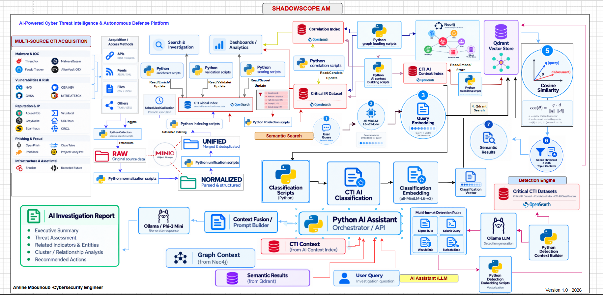
</p>

The architecture is composed of multiple interconnected intelligence layers.

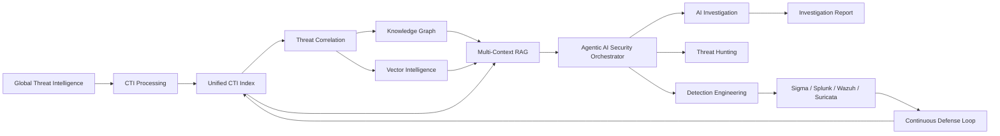

---

#  End-to-End Intelligence Flow

The complete ShadowScope AM workflow can be represented as:

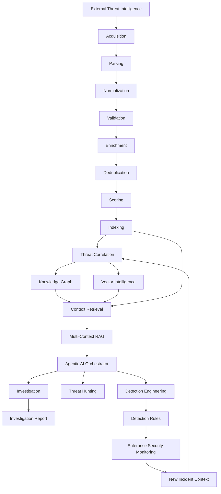

---

#  Core Capabilities

## 01 - Continuous Global Threat Intelligence Acquisition

ShadowScope AM continuously builds a global Cyber Threat Intelligence knowledge base from multiple intelligence categories.

### Intelligence domains

- Malware Intelligence
- Vulnerability Intelligence
- IP Reputation
- Phishing Intelligence
- Infrastructure Intelligence
- Threat Actors
- Campaigns
- TTPs
- Exploited Vulnerabilities
- External security intelligence

### Supported acquisition methods

| Method | Purpose |
|---|---|
| REST APIs | Real-time or scheduled intelligence retrieval |
| GraphQL | Structured provider queries |
| JSON | API and feed ingestion |
| CSV | Dataset ingestion |
| XML | Feed ingestion |
| STIX/TAXII | Structured Threat Intelligence exchange |
| External Feeds | Continuous threat intelligence acquisition |

Python collectors periodically retrieve and store new intelligence for downstream processing.

---

#  02 - Automated CTI Processing Pipeline

Raw threat intelligence cannot be consumed directly.

Each provider may use different:

- schemas,
- naming conventions,
- confidence models,
- risk scores,
- IOC representations,
- metadata formats.

ShadowScope AM therefore introduces an automated processing pipeline:

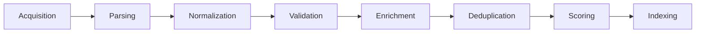

The objective is to transform heterogeneous threat feeds into a **unified intelligence model**.

---

#  03 - Unified Global CTI Knowledge Base

The normalized data is indexed and analyzed using **OpenSearch**.

The platform organizes intelligence around several entity types:

| Entity | Description |
|---|---|
| Indicator | IP, domain, URL, hash and other observables |
| Malware | Malware families and related intelligence |
| CVE | Vulnerability intelligence |
| Threat Actor | APT groups and adversaries |
| Campaign | Threat campaigns |
| ASN | Network infrastructure context |
| Country | Geographic infrastructure context |
| Threat Type | Threat classification |
| Cluster | Groups of related indicators |
| Source | Intelligence provider |
| Correlation | Relationships between entities |

OpenSearch provides:

- high-speed threat search,
- filtering,
- aggregation,
- enrichment retrieval,
- analytics,
- investigation support.

---

#  04 - Threat Correlation Engine

An IOC alone provides limited intelligence.

ShadowScope AM attempts to reconstruct the broader ecosystem surrounding the indicator.

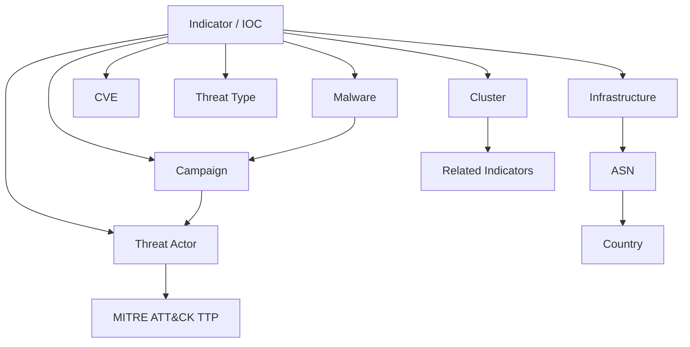

Correlation can consider multiple factors:

- common infrastructure,
- malware relationships,
- threat classification,
- intelligence source,
- geographic context,
- confidence,
- risk,
- temporal context,
- known relationships,
- similarity.

The goal is to move from:

> **Indicator**

to:

> **Contextualized Threat Intelligence**

---

#  05 - Cyber Threat Knowledge Graph

ShadowScope AM uses **Neo4j** to build a Cyber Threat Knowledge Graph.

Instead of representing threat intelligence as isolated records, the graph explicitly models relationships between entities.

### Example graph model

```text
Source
   │
   ▼
Indicator / IOC
   │
   ├──── Infrastructure ──── ASN ──── Country
   │
   ├──── Threat Type
   │
   ├──── Malware
   │         │
   │         ▼
   │      Campaign
   │         │
   │         ▼
   │     Threat Actor
   │         │
   │         ▼
   │    MITRE ATT&CK TTP
   │
   ├──── CVE
   │
   └──── Cluster ──── Related Indicators
```

### Investigation capabilities

The Knowledge Graph can support:

- IOC Pivoting
- Campaign Analysis
- Infrastructure Mapping
- Threat Actor Analysis
- Malware Relationship Discovery
- Threat Cluster Discovery
- Indirect Relationship Analysis

This provides a significantly richer view than traditional flat IOC databases.

---

#  06 - Vector Intelligence

ShadowScope AM adds a second intelligence representation based on embeddings.

Threat Intelligence content can be transformed into vector representations using:

**all-MiniLM-L6-v2**

and stored inside:

**Qdrant Vector Database**

This creates a semantic intelligence layer capable of retrieving content based on:

- contextual similarity,
- semantic meaning,
- related concepts,
- threat characteristics.

---

#  07 - AI-Powered Semantic Threat Hunting

Traditional Threat Intelligence searches often rely on exact indicators.

Example:

```text
IP = 185.x.x.x
```

But analysts may not always know the exact IOC.

ShadowScope AM enables broader natural-language searches such as:

> **Find recent infrastructure associated with credential-stealing malware targeting European organizations.**

The semantic hunting workflow:

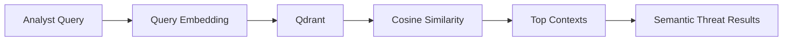

The objective is to move from:

| Traditional Search | Semantic Threat Hunting |
|---|---|
| Exact Match | Meaning |
| Keywords | Context |
| Known IOC | Threat Intent |
| Boolean Search | Similarity Search |

---

#  08 - Multi-Context RAG Architecture

ShadowScope AM integrates a cybersecurity-oriented Retrieval-Augmented Generation architecture.

The AI layer does not need to rely solely on generic LLM knowledge.

Instead, the platform retrieves relevant context from several intelligence layers.

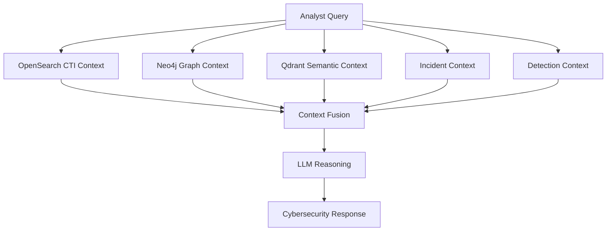

This architecture allows the AI layer to reason using the information available inside the security platform.

---

#  Agentic AI Security Orchestration

At the center of ShadowScope AM is an:

## **Agentic AI Security Orchestrator**

Its role is to coordinate the intelligence and security capabilities needed for a particular investigation.

### Agentic workflow

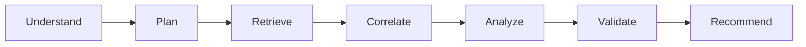

The architecture can coordinate several specialized capabilities.

---

###  CTI Intelligence Agent

Responsible for:

- Threat Intelligence retrieval
- IOC enrichment
- source aggregation
- external threat context
- reputation analysis

---

###  Threat Correlation Agent

Responsible for:

- entity relationships,
- infrastructure correlation,
- campaign relationships,
- malware links,
- IOC clustering,
- threat actor context.

---

###  Semantic Hunting Agent

Responsible for:

- vector similarity search,
- contextual threat discovery,
- semantic investigation,
- related threat retrieval.

---

###  Investigation Agent

Responsible for:

- investigation context reconstruction,
- evidence aggregation,
- threat assessment,
- relationship interpretation,
- investigation recommendations.

---

### 🛡 Detection Engineering Agent

Responsible for transforming intelligence into potential detection logic.

Possible targets include:

- Sigma
- Splunk
- Wazuh
- Suricata

---

#  Private / Local Cybersecurity LLM

ShadowScope AM can use locally hosted Large Language Models to keep sensitive investigation context within infrastructure controlled by the organization.

Current architecture:

| Component | Technology |
|---|---|
| LLM Runtime | Ollama |
| Local Model | Phi-3 Mini |
| Role | Investigation reasoning and generation |

The LLM operates above several context layers:

```text
Threat Intelligence
        +
Knowledge Graph
        +
Semantic Intelligence
        +
Security Events
        +
Detection Context
        ↓
LLM Reasoning
```

This enables exploration of privacy-conscious AI architectures for cybersecurity operations.

---

#  AI-Assisted Threat Investigation

One of the core workflows in ShadowScope AM is automated investigation enrichment.

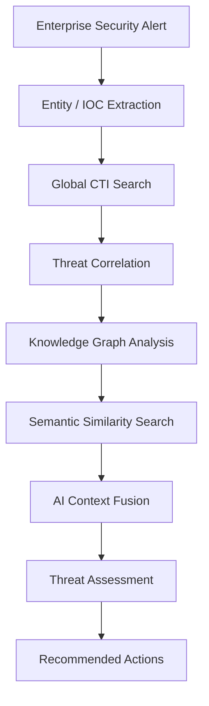

The investigation engine can help determine whether:

- the IOC is already known,
- related infrastructure has previously been observed,
- associated malware exists,
- related campaigns exist,
- threat actors are connected,
- vulnerabilities are potentially exploited,
- similar indicators belong to a larger cluster,
- additional detection opportunities exist.

---

#  Autonomous Investigation Report

The context gathered during investigation can be transformed into a structured security report.

### Executive Summary

High-level description of the threat.

### Threat Assessment

Analysis of:

- probable malicious activity,
- severity,
- confidence,
- contextual risk.

### Related Indicators & Entities

May include:

- IP addresses,
- domains,
- URLs,
- hashes,
- infrastructure,
- malware,
- campaigns,
- threat actors,
- vulnerabilities.

### Relationship Analysis

Relationships extracted from the Knowledge Graph.

### MITRE ATT&CK Context

Potentially relevant:

- tactics,
- techniques,
- adversary behavior.

### Recommended Actions

Possible analyst actions including:

- further investigation,
- monitoring,
- threat hunting,
- containment,
- detection creation.

---

#  AI Threat Classification Engine

Large CTI ecosystems generate significant analyst noise.

ShadowScope AM introduces an intelligence classification layer combining several signals:

```text
CTI Metadata
     +
Reputation
     +
Source Confidence
     +
Semantic Features
     +
Correlation
     +
Context
     ↓
Threat Classification
```

The objective is to help prioritize intelligence that deserves analyst attention.

---

# 🛡 Intelligence-to-Detection Engineering

One of the key principles of ShadowScope AM is:

> **Threat Intelligence should not stop at Threat Intelligence.**

Relevant intelligence can become **Detection Intelligence**.

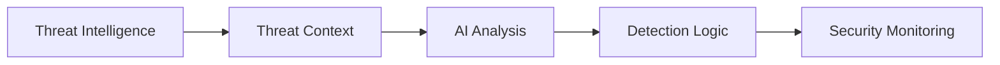

Supported detection-oriented outputs may include:

| Detection Technology | Output |
|---|---|
| Sigma | Sigma detection rules |
| Splunk | SPL queries |
| Wazuh | Wazuh rules |
| Suricata | IDS/IPS signatures |

---

#  Continuous Cyber Defense Loop

ShadowScope AM is designed around a feedback-driven security model.

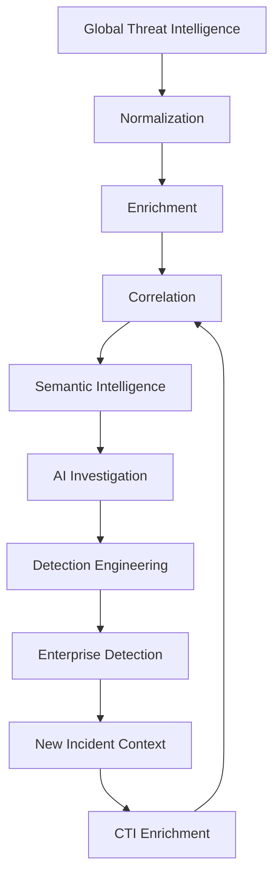

The principle is:

> External intelligence improves enterprise detection.

and:

> Enterprise incidents improve future intelligence and investigations.

---

#  Designed for Security Operations

ShadowScope AM is designed to support several security functions.

| Role | Potential Value |
|---|---|
|  SOC Analyst | Rapid alert enrichment and external threat context |
|  CTI Analyst | Multi-source intelligence centralization and correlation |
|  Threat Hunter | Semantic and relationship-based threat discovery |
|  Incident Responder | Faster IOC and infrastructure pivoting |
|  Detection Engineer | Intelligence-driven detection creation |
|  Security Engineer | Automation across CTI → Investigation → Detection |
|  Security Architect | Unified intelligence architecture |
|  Security Manager | Reduced investigation overhead and improved context |

---

#  Security Operations Value

##  Reduce Investigation Time

Reduce repetitive manual intelligence collection across multiple platforms.

##  Improve Threat Context

Move from isolated IOC information toward relationship-aware intelligence.

## Reduce Analyst Workload

Automate repetitive:

- acquisition,
- enrichment,
- correlation,
- context retrieval,
- report preparation.

##  Accelerate Threat Hunting

Enable analysts to search by:

- meaning,
- context,
- similarity,
- relationships.

##  Improve Detection Coverage

Turn new Threat Intelligence into new detection opportunities.

## Preserve Analyst Control

AI can:

- retrieve,
- correlate,
- analyze,
- summarize,
- recommend.

Critical security decisions can remain under human supervision.

---

#  Technology Architecture

| Architecture Layer | Technology |
|---|---|
|  Data Engineering | Python |
|  CTI Acquisition | REST, GraphQL, Feeds, JSON, CSV, XML, STIX/TAXII |
|  Search & Analytics | OpenSearch |
|  Knowledge Graph | Neo4j |
|  Vector Intelligence | Qdrant |
|  Embeddings | all-MiniLM-L6-v2 |
|  Local LLM Runtime | Ollama |
|  Local LLM | Phi-3 Mini |
|  Threat Modeling | MITRE ATT&CK |
|  Detection | Sigma, Splunk, Wazuh, Suricata |
|  Security Orchestration | Python AI Assistant / API |

---

# Technical Demonstrations

The following technical demonstrations provide practical validation of the main capabilities implemented within **ShadowScope AM**.

Each demo focuses on a specific layer of the platform and progressively demonstrates the complete security intelligence lifecycle - from multi-source threat intelligence acquisition to correlation, investigation, semantic intelligence, AI-assisted analysis and detection engineering.

The objective is to demonstrate the platform through real execution results, system outputs and operational workflows rather than architecture diagrams alone.

---

## Demo 01 - Global CTI Pipeline

The **Global CTI Pipeline** demonstrates the first intelligence layer of ShadowScope AM.

Its objective is to collect heterogeneous Cyber Threat Intelligence from multiple external sources and prepare it for downstream processing through a unified pipeline.

The complete workflow covers:

**Multi-Source Acquisition > Raw CTI Storage > Normalization > Enrichment > Deduplication > Scoring > Indexing**

This pipeline establishes the intelligence foundation used by the correlation, knowledge graph, semantic search and AI investigation layers of the platform.

### Capture 01 - Multi-Source CTI Acquisition

The first stage validates the automated global CTI acquisition layer across multiple intelligence providers and intelligence domains.

20 CTI collectors were successfully tested, covering vulnerability intelligence, malware intelligence, phishing intelligence, infrastructure reputation, threat knowledge and external security feeds.

The collection process is **automated and executed on a daily schedule**, continuously refreshing the platform with newly available threat intelligence. Sources providing frequently updated feeds or APIs can be ingested as soon as the scheduled collection cycle runs.

Raw intelligence is stored in **MinIO** before being processed by the downstream CTI pipeline.

<p align="center">
  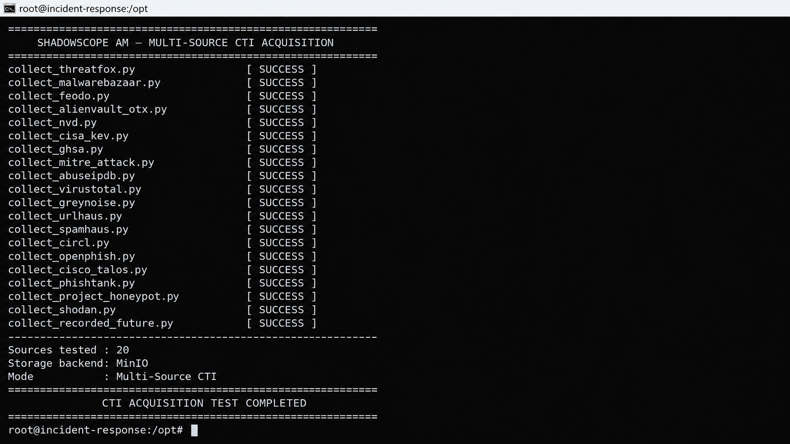
</p>

**Validation Result:** `20/20 CTI Collectors Successful` · `Automated Daily Acquisition` · `Storage Backend: MinIO` · `Mode: Multi-Source CTI`


### Capture 02 — Raw CTI Storage Layer

Threat intelligence collected from multiple external sources is centralized in the **MinIO raw intelligence layer** before downstream processing.

Each source is logically separated within the `cti/raw/` storage hierarchy, preserving the original collected data and its source provenance.

This layer provides a persistent foundation for normalization, enrichment, deduplication, scoring and indexing while allowing raw intelligence to remain available for traceability and reprocessing.

At the time of validation, the raw CTI storage contained **85 objects representing approximately 436.8 MiB of collected intelligence** across multiple CTI providers.

<p align="center">
  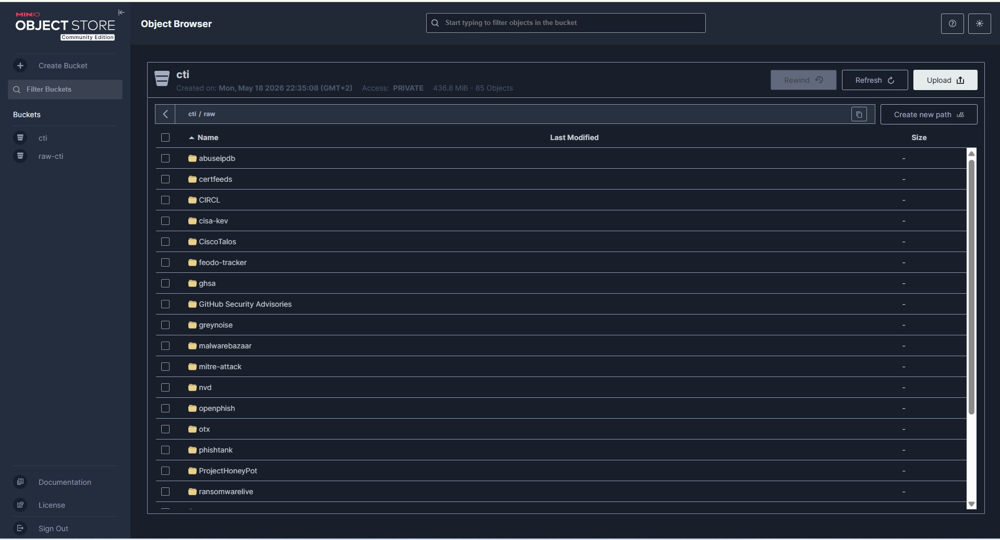
</p>

**Validation Result:** `Multi-Source Raw CTI Stored` · `85 Objects` · `436.8 MiB` · `Backend: MinIO`

### Capture 03 - Multi-Source CTI Normalization

Threat intelligence collected from heterogeneous sources is automatically processed by the normalization layer before being used by downstream intelligence components.

Each supported CTI source is transformed from its original provider-specific format into a structured representation adapted to the ShadowScope AM intelligence pipeline.

Normalization standardizes key information such as source identification, entity type, timestamps, indicators, metadata and source-specific intelligence attributes while preserving provenance.

The example below shows the normalization of an **RSS security intelligence feed**, where raw feed entries are transformed into structured security-news objects.

<p align="center">
  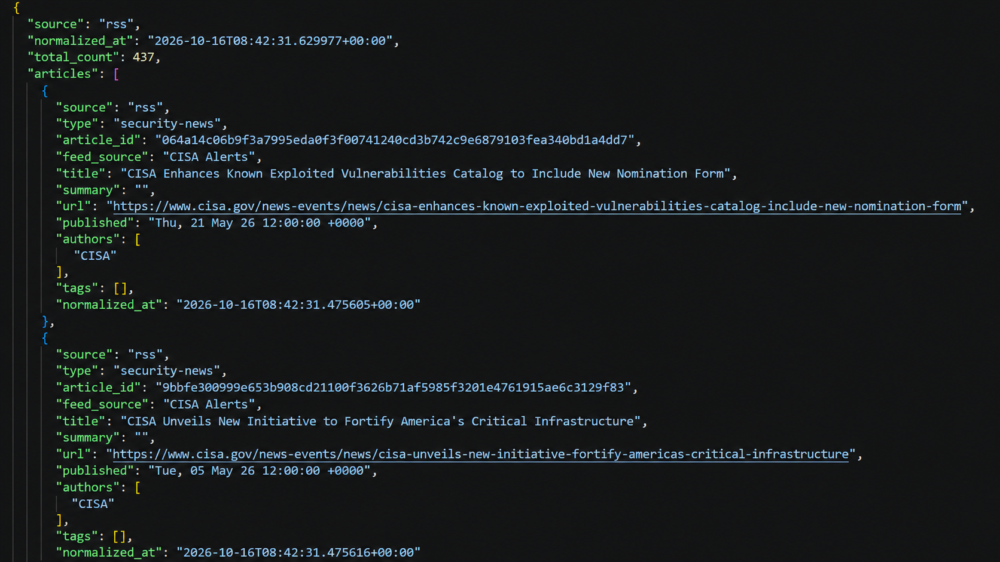
</p>

**Example:** `Source: RSS` · `Type: Security News` · `437 Records Normalized` · `Structured CTI Output`

### Capture 04 - Unified CTI Schema

To enable consistent processing across heterogeneous intelligence providers, ShadowScope AM transforms normalized data into a **Unified CTI Schema**.

Instead of keeping provider-specific structures, intelligence from vulnerability, malware, phishing, infrastructure, threat actor and external CTI sources is represented through a common data model.

The unified schema standardizes core intelligence attributes such as:

- unique entity identifier,
- entity and indicator type,
- source provenance,
- threat classification,
- malware families,
- threat actors / APT groups,
- campaigns,
- severity and confidence,
- first-seen and last-seen timestamps,
- tags and references,
- related CVEs and IOCs,
- contextual description,
- raw-source references,
- update timestamp.

Not every intelligence object requires every field.  
Fields are populated according to the available context and the type of intelligence being represented, while preserving a consistent schema across the platform.

This allows downstream components such as correlation, enrichment, search, knowledge graphs, semantic intelligence and AI investigation to consume CTI through a standardized representation.

#### Unified CTI Object Example

The example below shows a vulnerability intelligence object created from multiple CTI sources and represented using the common ShadowScope AM schema.

<p align="center">
  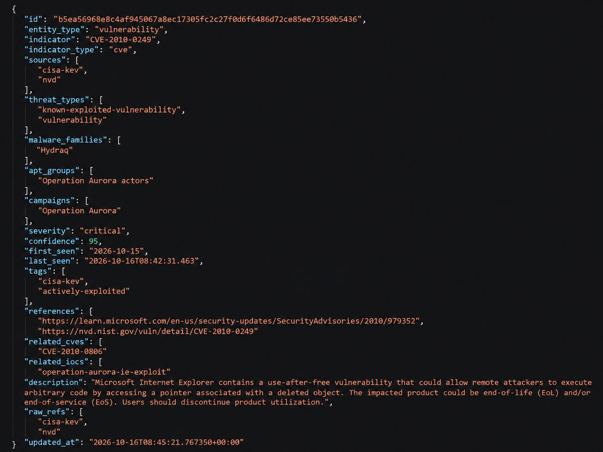
</p>

In this example, **CVE-2010-0249** is represented as a unified vulnerability entity with intelligence originating from multiple sources, including **CISA KEV** and **NVD**, while maintaining common contextual fields for severity, confidence, threat relationships, references and related entities.

**Validation Result:** `Multi-Source Intelligence Unified` · `Common CTI Schema` · `Source Provenance Preserved`


#  What Makes ShadowScope AM Different?

ShadowScope AM explores the convergence of several areas that are often separated in traditional security architectures.

<table>
<tr>
<td align="center">

###  CTI

Global Threat Intelligence

</td>

<td align="center">

###  Correlation

Connected threat context

</td>

<td align="center">

###  Graph Intelligence

Relationship discovery

</td>
</tr>

<tr>
<td align="center">

###  Vector Intelligence

Semantic similarity

</td>

<td align="center">

###  RAG

Grounded AI context

</td>

<td align="center">

###  Agentic AI

Security orchestration

</td>
</tr>

<tr>
<td align="center">

###  Investigation

Threat analysis

</td>

<td align="center">

###  Detection

Detection Engineering

</td>

<td align="center">

###  Automation

Continuous security workflows

</td>
</tr>
</table>

The objective is to create a unified security intelligence layer capable of connecting the entire lifecycle:

> **Threat Intelligence → Understanding → Investigation → Detection**

---

#  Platform Vision

ShadowScope AM explores the progression from:

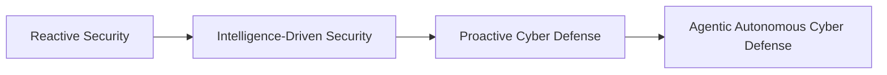

The objective is **not uncontrolled autonomous security response**.

The vision is to combine:

- external Threat Intelligence,
- internal enterprise context,
- Knowledge Graphs,
- semantic intelligence,
- LLM reasoning,
- AI agents,
- detection systems,

while maintaining appropriate analyst oversight.

---

#  Roadmap

### Intelligence

- additional CTI sources
- deeper threat enrichment
- improved source confidence
- temporal intelligence
- entity resolution
- better threat clustering

### Knowledge Graph

- richer entity relationships
- campaign modeling
- infrastructure evolution
- graph-based threat scoring
- multi-hop investigation

### Semantic Intelligence

- improved embeddings
- hybrid search
- contextual reranking
- semantic clustering

### Agentic AI

- specialized security agents
- dynamic investigation planning
- tool selection
- agent collaboration
- investigation memory
- validation agents

### Detection Engineering

- rule validation
- detection quality scoring
- ATT&CK mapping
- multi-SIEM generation
- rule lifecycle management

### Human-in-the-Loop

- analyst validation
- evidence review
- recommendation approval
- investigation feedback

---

#  Documentation

Detailed technical documentation will be progressively available in:

```text
docs/
│
├── 01-platform-architecture.md
├── 02-global-cti-pipeline.md
├── 03-data-normalization.md
├── 04-threat-correlation.md
├── 05-knowledge-graph.md
├── 06-vector-intelligence.md
├── 07-semantic-threat-hunting.md
├── 08-multi-context-rag.md
├── 09-agentic-ai-orchestrator.md
├── 10-ai-investigation.md
├── 11-threat-classification.md
├── 12-detection-engineering.md
└── 13-continuous-defense-loop.md
```

---

#  Project Status


ShadowScope AM is an evolving cybersecurity engineering platform.

The current architecture demonstrates the integration of:

**CTI · Data Engineering · Graph Intelligence · Vector Intelligence · Semantic Search · RAG · LLMs · Agentic AI · Investigation · Detection Engineering**

Additional capabilities, integrations and demonstrations will continue to be added.

---

#  Security & Responsible Automation

ShadowScope AM follows a **human-in-the-loop security philosophy**.

AI capabilities are intended to assist with:

- information retrieval,
- correlation,
- investigation,
- contextualization,
- classification,
- recommendations,
- detection engineering.

High-impact security decisions should remain reviewable and controllable by security professionals.

---

#  Project Author

<div align="center">

## Amine Maouhoub

### Cybersecurity Engineer & M2 Cybersecurity Manager 

**Cyber Threat Intelligence · AI Security · Threat Hunting · Detection Engineering · Security Automation**

<br>

### SHADOWSCOPE AM

**Global Intelligence. Connected Threats. Agentic Investigation. Proactive Defense.**

### From Threat Intelligence to Autonomous Cyber Defense.

</div>
