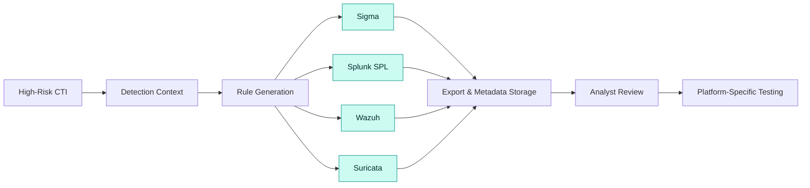

<div align="center">

# 🛡️ SHADOWSCOPE AM

### Intelligence-Driven Cyber Defense, From Threat Data to Detection

**Advanced Cyber Threat Intelligence · Knowledge Graphs · Semantic Threat Hunting · Agentic AI · Detection Engineering**

<br>


<br>

**COLLECT** &nbsp;·&nbsp; **ENRICH** &nbsp;·&nbsp; **CORRELATE** &nbsp;·&nbsp; **INVESTIGATE** &nbsp;·&nbsp; **DETECT**

<br>

[**Overview**](#overview) &nbsp;•&nbsp; [**Architecture**](#platform-architecture) &nbsp;•&nbsp; [**Capabilities**](#core-capabilities) &nbsp;•&nbsp; [**Live Results & Demos**](#technical-demonstrations) &nbsp;•&nbsp; [**Roadmap**](#roadmap) &nbsp;•&nbsp; [**Contact**](#collaboration--contact)

</div>

---

## Overview

**ShadowScope AM** is an advanced cybersecurity engineering platform that connects global cyber threat intelligence with contextual investigation, relationship-based threat discovery, semantic search, local language-model analysis, and multi-format detection engineering.

The platform addresses a recurring operational problem: **having more threat indicators does not automatically mean having better threat intelligence.** Individual IPs, domains, CVEs, malware references, and external feeds become useful when analysts can establish context, understand relationships, assess relevance, and turn findings into security action.

ShadowScope AM brings these steps together in a single technical workflow:

> **Global Intelligence → Unified CTI → Risk-Based Prioritization → Threat Correlation → Graph & Vector Intelligence → AI-Assisted Investigation → Detection Engineering**

The goal is not to create another isolated IOC repository. It is to develop an **intelligence layer between external threat data and security operations**, reducing manual investigation steps while preserving evidence, explainability, and analyst control.

### Platform highlights

| | Recorded technical milestone |
|:--|:--|
| **20 / 20** | CTI collectors completed successfully in the documented acquisition run |
| **85 objects** | Approximately **436.8 MiB** of raw intelligence in the captured MinIO snapshot |
| **107 nodes** | **106 relationships** in an IOC-centric Neo4j investigation |
| **23 indicators** | Retrieved for the FlowerStorm malware investigation |
| **384 dimensions** | Normalized semantic embeddings using `all-MiniLM-L6-v2` |
| **4 formats** | Detection content generated for **Sigma, Splunk, Wazuh, and Suricata** |
| **8 demos** | Technical demonstrations covering the platform's end-to-end intelligence lifecycle |

> [!NOTE]
> Figures above are recorded results from specific test runs, not real-time system counters, independent benchmarks, or claims of production deployment.

---

## The Problem We're Solving

Cyber threat intelligence is fragmented across public feeds, reputation services, vulnerability databases, security advisories, and investigation tools. The information may describe the same infrastructure or campaign using different schemas, confidence levels, timestamps, and identifiers.

This creates four practical challenges:

1. **Fragmented data:** Threat information is spread across sources and formats, complicating consolidation and traceability.
2. **Limited context:** An isolated IOC does not explain connected infrastructure, malware associations, related vulnerabilities, or campaigns.
3. **Investigation overhead:** Analysts repeatedly search multiple services and manually reconstruct relationships.
4. **The intelligence-to-detection gap:** Useful CTI often stays in reports instead of becoming reviewed detection content.

**ShadowScope AM connects collection, analysis, retrieval, and detection preparation within one extensible architecture.**

---

## Platform Architecture

<p align="center">
  
</p>

### End-to-end intelligence pipeline

```mermaid
flowchart LR
    A["External CTI Sources"] --> B["Python Collectors"]
    B --> C["MinIO / Raw CTI"]
    C --> D["Normalize / Enrich / Validate / Score"]
    D --> E["OpenSearch / cti-global"]
    E --> F["Risk-Based Selection / cti-ir"]
    F --> G["Correlation Engine"]
    G --> H["Neo4j / Knowledge Graph"]
    F --> I["AI Context Builder"]
    G --> I
    I --> J["Embeddings / Qdrant"]
    F --> K["Investigation API / Local LLM"]
    J --> K
    H -. "Graph context integration" .-> K
    F --> L["Detection Engineering"]
    K --> L
    L --> M["Sigma / Splunk / Wazuh / Suricata"]
    M --> N["Analyst Review & Validation"]

    classDef data fill:#DBEAFE,stroke:#2563EB,color:#10203B;
    classDef intelligence fill:#EDE9FE,stroke:#7C3AED,color:#251343;
    classDef action fill:#CCFBF1,stroke:#0F766E,color:#043F39;
    class C,E,F,H data;
    class G,I,J,K intelligence;
    class L,M,N action;
```



The architecture separates raw-data preservation, structured intelligence, graph relationships, vector retrieval, and detection generation. Each layer provides an independently useful capability while enriching subsequent investigation steps.

### Technology stack

| Engineering layer | Technology | Responsibility |
|:--|:--|:--|
| CTI acquisition | **Python · REST · GraphQL · JSON · CSV · XML · STIX/TAXII** | Multi-source ingestion |
| Raw intelligence storage | **MinIO** | Raw payload retention and source provenance |
| CTI indexing and analytics | **OpenSearch** | Search, aggregation, prioritization, contextual storage |
| Threat correlation | **Python · OpenSearch** | Shared-attribute analysis and cluster generation |
| Knowledge graph | **Neo4j · Cypher** | Entity and relationship modeling |
| Context engineering | **Python** | Structured CTI-to-text transformation |
| Embeddings | **Sentence Transformers · all-MiniLM-L6-v2** | 384-dimensional text representations |
| Vector database | **Qdrant** | Cosine-similarity retrieval and metadata storage |
| Investigation services | **FastAPI** | Analyst questions and context orchestration |
| Local language model | **Ollama · Phi-3 Mini** | Local inference and investigation summaries |
| Detection engineering | **Sigma · Splunk SPL · Wazuh · Suricata** | Detection content generation |
| Adversary context | **MITRE ATT&CK** | Tactics and techniques as investigation context |

### Intelligence stores

| Name | Data role |
|:--|:--|
| `cti/raw/` | Source-separated raw CTI objects in MinIO |
| `cti-global` | Normalized, unified global CTI records in OpenSearch |
| `cti-ir` | Scored intelligence selected for investigation |
| `cti-correlations` | Shared-attribute correlations and cluster metadata |
| `cti-ai-context` | Descriptive CTI contexts and references to source records |
| `cti_ai_vectors` | Semantic vectors and contextual CTI payloads in Qdrant |
| `cti_detection_vectors` | Generated detection records and associated metadata |
| Neo4j graph | IOCs, infrastructure, malware, sources, CVEs, clusters, relationships |

---

## Core Capabilities

### 01 — Global Threat Intelligence Acquisition

Python collectors ingest intelligence from multiple external sources covering malware, vulnerability advisories, phishing URLs, malicious domains and IPs, threat actors, campaigns, reputation information, and infrastructure. The demonstrated configuration executes collection on a **daily schedule**, preserving original payloads in MinIO before processing.

### 02 — CTI Normalization, Enrichment & Validation

Raw feed records are converted into a unified CTI model with consistent fields for indicator identity, source, threat classification, timestamps, severity, confidence, references, and contextual relationships. Network and infrastructure enrichment can incorporate DNS, reverse DNS, RDAP, ASN, ownership, geographic context, cloud/CDN classification, and false-positive considerations.

A separate rule-based validation stage attaches an explainable status and supporting reasons. Risk scoring then creates a practical analyst priority rather than leaving each record as an unranked indicator.

### 03 — Risk-Based Investigation Intelligence

The investigation pipeline promotes eligible intelligence from `cti-global` into `cti-ir` according to defined selection criteria:

- Scoring has been completed; validation status is `malicious` or `suspicious`.
- Risk score is **70 or higher**, with operational priority **P1** or **P2**.
- Benign shared infrastructure and high false-positive-risk records are excluded.
- The original record remains in the global CTI store.

| Risk score | Investigation tier | Analyst action |
|:--|:--|:--|
| 90–100 | **Critical** | Investigate immediately |
| 70–89 | **High** | Investigate |

### 04 — Automated Threat Correlation

The correlation engine evaluates shared characteristics across prioritized intelligence: ASN and network ownership, countries, malware families, threat classifications, APT/campaign references, CVEs, source provenance, and tags. Correlations involving at least two entities are indexed in `cti-correlations`, with cluster IDs and supporting risk metadata.

**A shared attribute is a lead for investigation, not proof of common attacker control.**

### 05 — Cyber Threat Knowledge Graph

Neo4j connects `Indicator`, `Malware`, `ThreatType`, `ASN`, `Country`, `Source`, `Campaign`, `APT`, `CVE`, `Correlation`, and `Cluster` nodes. Relationships such as `ASSOCIATED_WITH_MALWARE`, `HAS_CORRELATION`, `BELONGS_TO_CLUSTER`, `USES_ASN`, and `REPORTED_BY` support pivoting between related entities.

This lets an analyst begin with a domain, malware family, or cluster and explore its documented CTI neighborhood instead of searching each entity separately.

### 06 — Context Engineering & Vector Intelligence

The context-building pipeline converts structured records from `cti-ir` and `cti-correlations` into descriptive, source-linked text stored in `cti-ai-context`. `sentence-transformers/all-MiniLM-L6-v2` converts those contexts into **384-dimensional normalized embeddings** stored in Qdrant with cosine similarity.

An analyst can therefore retrieve semantically related intelligence, even when an exact IOC or identical keyword is not provided.

### 07 — Semantic Threat Hunting

Semantic search turns natural-language requests into vector queries and returns ranked CTI contexts. Operational metadata—including severity, risk score, priority, correlation IDs, and source references—helps an analyst interpret results. Similarity is treated as **retrieval relevance**, not independent confirmation of maliciousness.

### 08 — AI-Assisted Investigation & Local LLM

The investigation interface uses **FastAPI**, semantic retrieval through **Qdrant**, structured CTI context from **OpenSearch**, and a locally hosted LLM through **Ollama**. Explicit relationship retrieval from **Neo4j** is part of the multi-context architecture; the recorded LLM demonstration exposed a graph connectivity issue, identified transparently in Demo 07.

The intended agentic approach separates CTI retrieval, correlation, semantic hunting, investigation, and detection responsibilities. Fully autonomous multi-agent operation is a future development objective—not a claim established by the current demos.

### 09 — Intelligence-to-Detection Engineering

Prioritized CTI can be transformed into detection content for **Sigma, Splunk SPL, Wazuh, and Suricata**. Generated records retain IOC references, risk metadata, descriptions, output format, export location, and deployment status. Rule deployment requires syntax validation, environment-specific mappings, testing, and analyst approval.

---

## Technical Demonstrations

> Eight documented demonstrations show the actual engineering workflow—from collection and storage to graph exploration, semantic intelligence, LLM-assisted investigation, and multi-format detection generation. The figures below are captured test results.

### Demo 01 — Global CTI Acquisition & Unified Processing

**Objective:** verify the acquisition and processing foundations of the CTI platform.

**01 / Multi-source collection**

<p align="center"></p>

**Observed:** `20/20 collectors successful` · `Scheduled daily collection` · `Raw storage: MinIO`. The collectors cover vulnerabilities, malware, phishing, reputation, infrastructure, and external security intelligence.

**02 / Raw intelligence in MinIO**

<p align="center"></p>

**Observed:** `85 objects` · `Approximately 436.8 MiB` · `cti/raw/` source-separated hierarchy. Original records are retained for provenance and reprocessing.

**03 / CTI normalization**

<p align="center"></p>

**Observed:** `437 normalized RSS security-news records` transformed into structured objects for downstream processing.

**04 / Unified CTI schema**

<p align="center"></p>

A unified example for **CVE-2010-0249** combines intelligence from sources including CISA KEV and NVD, while maintaining common severity, confidence, references, entity relationships, and source provenance.

**Demo result:** multi-source intelligence is collected, stored, normalized, and represented in a shared model.

---

### Demo 02 — Threat Enrichment, Validation & Risk Scoring

**Objective:** produce contextualized, explainable threat assessments from normalized CTI.

**01 / Threat context enrichment**

<p align="center"></p>

The enrichment record demonstrates infrastructure context such as DNS/RDAP, ASN, network classification, hosting context, and false-positive indicators.

**02 / Rule-based validation**

<p align="center"></p>

For `211.102.140.0/22`, the engine produced **Suspicious**, with a **60% malicious-likelihood estimate** and a **legitimacy score of 40**. These are internal heuristic outputs, not externally calibrated probabilities.

**03 / Operational risk scoring**

<p align="center"></p>

The same network indicator, with available PlugX and **CVE-2010-0249** associations, received **100/100**, **Critical**, and **P1**, with an *Investigate Immediately* action.

**Demo result:** threat context, validation rationale, scoring, and analyst priority are available in the intelligence record.

---

### Demo 03 — Risk-Based Investigation & Response Queue

**Objective:** move selected CTI records into a dedicated analyst investigation layer instead of surfacing every collected indicator.

<p align="center"></p>

The dashboard consolidates P1/P2 indicators, risk and validation distributions, malware intelligence, vulnerabilities, campaigns, ransomware-related activity, and proposed analyst actions. The investigation index enriches the selected records with `ir_selected`, `ir_selected_at`, `ir_status`, `ir_case_priority`, `ir_action`, and `ir_index_version`.

**Demo result:** a dedicated `cti-ir` index provides a focused operational queue while retaining the original intelligence in `cti-global`.

---

### Demo 04 — Automated Correlation & Neo4j Knowledge Graph

**Objective:** demonstrate investigations driven by relationships rather than isolated IOC lookups.

**01 / IOC-centric graph exploration**

**Target:** `node828765.dwservice.net`

```cypher
MATCH (i:Indicator {value: "node828765.dwservice.net"})-[r]-(n)
RETURN i, r, n;
```

<p align="center"></p>

| Graph result | Count |
|:--|--:|
| Total nodes | **107** |
| Total relationships | **106** |
| Indicators | 1 |
| Malware associations | 16 |
| Correlations | 43 |
| Clusters | 43 |
| ASN / country / source / threat type | 1 each |

**02 / Automated correlation clusters**

```cypher
MATCH (cl:Cluster)<-[:BELONGS_TO_CLUSTER]-(c:Correlation)
MATCH (i:Indicator)-[:HAS_CORRELATION]->(c)
RETURN cl, c, i
LIMIT 100;
```

<p align="center"></p>

**Observed:** `119 nodes` · `93 relationships` · `100 indicators` · `7 correlations` · `7 clusters`. The output also includes two countries and shared source/infrastructure attributes.

**03 / Malware-centric graph — FlowerStorm**

```cypher
MATCH (m:Malware {name: "FlowerStorm"})<-[r:ASSOCIATED_WITH_MALWARE]-(i:Indicator)
RETURN m, r, i;
```

<p align="center"></p>

**Observed:** `1 malware entity` · `23 associated indicators` · `24 total nodes` · `23 relationships`.

**04 / Extended malware context**

<p align="center"></p>

**Observed:** `61 nodes` · `113 relationships` · `23 indicators` · `16 correlations` · `16 clusters` · `2 ASNs`.

These relationship views demonstrate direct IOC pivoting, common-attribute clustering, and malware-based discovery. Additional evidence is needed before treating a graph relationship as confirmed threat-actor attribution.

**Demo result:** explicit CTI relationships support more informed and repeatable threat investigations.

---

### Demo 05 — AI Context Engineering & Vector Intelligence

**Objective:** transform structured CTI into searchable semantic representations without losing original record references.

The context builder reads `cti-ir` and `cti-correlations`, generates descriptions containing risk, severity, priority, validation, malware, infrastructure, campaigns, CVEs, and correlations where available, and writes them to `cti-ai-context`.

| Component | Configuration |
|:--|:--|
| Context engine | `06_AI_Assistant/ai_context_builder.py` |
| Embedding engine | `06_AI_Assistant/embedding_engine.py` |
| Model | `sentence-transformers/all-MiniLM-L6-v2` |
| Embedding dimensions | **384** |
| Normalization | Enabled |
| Vector similarity | Cosine |
| Vector collection | `cti_ai_vectors` |

**Structured context illustration:**

```json
{
  "indicator": "suspicious.example",
  "entity_type": "indicator",
  "risk_score": 95,
  "risk_level": "critical",
  "priority": "P1",
  "validation_status": "malicious",
  "threat_types": ["phishing"],
  "sources": ["threat-intelligence-feed"]
}
```

The text representation preserves these attributes in readable form and keeps a reference to its originating CTI document.

**01 / Qdrant vector storage**

<p align="center"></p>

The captured point represents a phishing-URL `indicator_context` from `cti-ir`, with **risk score 100**, **Critical**, **P1**, **malicious** validation, and `phishing-url` / `phishtank` tags. The Qdrant payload retains source and processing metadata; the model is configured for 384-dimensional embeddings.

**Demo result:** CTI contexts are transformed into vector records suitable for downstream semantic retrieval and investigation.

---

### Demo 06 — Semantic Threat Search

**Objective:** search threat and correlation intelligence in natural language, not only by exact IOC or keyword.

**Recorded analyst query:**

```text
Find high-risk indicators sharing ASN infrastructure or threat correlation clusters.
```

| Search parameter | Value |
|:--|:--|
| Top K | **10** |
| Minimum similarity | **0.30** |
| Retrieval | Qdrant cosine similarity over embedded CTI contexts |

**01 / Query and highest-ranked results**

<p align="center"></p>

Returned results were primarily `correlation_context` records with the type `shared_asn_org`. Recorded similarity scores were approximately **0.64–0.67**, with **Critical**, **risk 100**, and **P1** metadata in the displayed results.

**02 / Extended search results**

<p align="center"></p>

Additional contexts referred to ASN organizations including VNET a.s., TIMENET SPA, Metronet, FranTech Solutions, Baxet Group Inc., Awarenes Software Limited, and SECURED SERVERS LLC. These names are present in retrieved CTI context; their inclusion alone does **not** imply wrongdoing by the organizations.

**Additional video scenarios reserved for publication:**

1. **Phishing:** `Find high-risk phishing URLs reported by PhishTank.`
2. **Malware:** `Find threat intelligence related to FlowerStorm malware and associated indicators.`
3. **Infrastructure:** `Find high-risk indicators sharing ASN infrastructure or threat correlation clusters.`

<!-- Add demonstration-video links here when the recordings are published. -->

**Demo result:** the retrieval layer returned risk-aware, semantically related CTI correlation contexts. Similarity indicates conceptual relevance, not proof of malicious relationships.

---

### Demo 07 — Local LLM & AI-Assisted Threat Investigation

**Objective:** demonstrate the investigation API, evidence retrieval, and structured natural-language synthesis using a locally hosted LLM.

**01 / Investigation request**

```http
POST /ask
Content-Type: application/json
```

```json
{
  "question": "What is the risk associated with node828765.dwservice.net?",
  "top_k": 3
}
```

<p align="center"></p>

**02 / Retrieved semantic intelligence**

<p align="center"></p>

The API returned **HTTP 200** and three semantic contexts:

| Retrieved indicator | Similarity | Risk | Priority | CTI source |
|:--|--:|--:|:--|:--|
| `66.232.15.73` | 0.4626 | 90 | P1 | AbuseIPDB |
| `40.127.67.83` | 0.4612 | 78 | P2 | AbuseIPDB |
| `31.14.32.7` | 0.4588 | 90 | P1 | AbuseIPDB |

These records are semantically retrieved evidence candidates; this result **does not independently connect them to the queried domain**.

**03 / Knowledge graph integration status**

<p align="center"></p>

The Neo4j retrieval attempt experienced a **connection failure** during this execution. Qdrant semantic retrieval succeeded, but graph-enriched context was unavailable in the recorded API run.

**04 / Generated threat assessment**

<p align="center"></p>

The assistant produced a structured report with an executive summary, threat classification, risk explanation, and related-intelligence narrative. Because the graph retrieval failed and the retrieved IPs were not verified as direct matches, some stated associations require independent confirmation.

| Component | Demonstration outcome |
|:--|:--|
| FastAPI request / response | **Observed operational — HTTP 200** |
| Qdrant semantic retrieval | **Successful** |
| CTI risk metadata | **Returned** |
| Local LLM response generation | **Observed** |
| Neo4j context retrieval | **Connection failure during test** |
| Evidence-grounded IOC attribution | **Requires further validation** |
| Fully autonomous multi-agent investigation | **Not established by this run** |

**Demo result:** functioning request, retrieval, and response synthesis with clearly identified graph-integration and evidence-verification work remaining.

---

### Demo 08 — Automated Detection Engineering

**Objective:** transform prioritized CTI into structured detection content for four monitoring ecosystems, while separating generation from deployment.



**01 / Multi-format detection record**

<p align="center"></p>

The captured record in `cti_detection_vectors` represents a **URL-based indicator**, with **risk 100/100**, **Critical**, **P1**, action **Investigate**, status **Generated**, and export path `/opt/cti-detections`.

| Format | Stored output | Security use |
|:--|:--|:--|
| **Sigma** | `sigma_rule` | Portable SIEM detection logic |
| **Splunk** | `splunk_query` | SPL searches and threat hunting |
| **Wazuh** | `wazuh_rule` | XML-based security event detection |
| **Suricata** | `suricata_rule` | IDS/IPS signature content |

Each generated detection record also includes context such as IOC value, title, severity, risk, priority, output location, timestamps, and deployment status.

**Demo result:** four detection formats were generated and their metadata recorded in Qdrant. No production deployment, engine-level syntax validation, detection-rate benchmark, or false-positive assessment is implied by the screenshot.

---

## Built for Security Operations

| Team / role | How ShadowScope AM can support its workflow |
|:--|:--|
| **SOC analysts** | Prioritized CTI triage, enrichment, and associated-threat context |
| **CTI analysts** | Centralized feeds, provenance, correlation, and graph pivoting |
| **Threat hunters** | Natural-language hunting and relationship-based discovery |
| **Incident responders** | IOC investigation, infrastructure analysis, and evidence organization |
| **Detection engineers** | Candidate Sigma, Splunk, Wazuh, and Suricata content |
| **Security architects** | Integration of structured search, knowledge graphs, vectors, and local inference |
| **Security operations leaders** | More consistent context for analyst review and detection planning |

### What differentiates the architecture

**One intelligence lifecycle, multiple analysis methods.** OpenSearch supports structured intelligence and analytics; Neo4j models explicit relationships; Qdrant enables retrieval by semantic meaning; the local LLM presents context to analysts; the detection engine turns selected findings into draft rules.

This hybrid design allows security teams to combine **exact matching, correlation, graph traversal, semantic retrieval, and human-reviewed detection engineering** instead of relying on any single method.

---

## Validation Status

| Capability | Recorded status |
|:--|:--|
| CTI collection, MinIO storage, normalization | **Demonstrated** — Demo 01 |
| Enrichment, rule-based validation, scoring | **Demonstrated** — Demo 02 |
| Dedicated risk-based investigation queue | **Demonstrated** — Demo 03 |
| Correlation, cluster discovery, Neo4j queries | **Demonstrated** — Demo 04 |
| AI context creation and Qdrant vector storage | **Demonstrated** — Demo 05 |
| Natural-language semantic search | **Demonstrated** — Demo 06 |
| FastAPI + Qdrant + local LLM response | **Demonstrated with limitations** — Demo 07 |
| Neo4j context retrieval inside the LLM API | **Not completed during Demo 07** |
| Multi-format detection generation and storage | **Demonstrated** — Demo 08 |
| Detection rule quality, production monitoring, autonomous response | **Requires further testing and integration** |

These statements describe the **specific captured demonstration state**. They should not be read as independent certification, performance evaluation, or an assertion that all roadmap components are production-ready.

---

## Roadmap

| Focus area | Planned engineering work |
|:--|:--|
| **Threat intelligence quality** | Additional sources, source-confidence improvement, temporal context, richer entity resolution |
| **Correlation & graphs** | Better cluster precision, multi-hop analysis, infrastructure evolution, campaign-level relationships |
| **Semantic intelligence** | Hybrid search, reranking, retrieval evaluation, relevance feedback |
| **Investigation & RAG** | Reliable Neo4j connectivity, exact IOC verification, source-grounded answers, structured evidence citations |
| **Agentic security workflows** | Specialized tools, controlled agent coordination, auditable decisions, approval gates |
| **Detection engineering** | Rule syntax verification, target-field mapping, false-positive testing, ATT&CK mapping, rule lifecycle management |
| **Operational maturity** | Reproducible tests, observability, secrets handling, deployment automation, measurable performance |

The long-term direction is a **continuously improving intelligence-to-detection loop** in which threat data informs investigations, analysts validate outputs, and confirmed findings improve subsequent detection coverage.

---

## Security & Responsible Automation

ShadowScope AM is designed around a **human-in-the-loop** operational model. Generated risk assessments, suggested associations, and detection rules should be reviewed against original evidence and tested before action.

- **Provenance matters.** CTI conclusions must remain traceable to source records.
- **Correlation is not attribution.** Shared infrastructure or semantic similarity does not automatically establish common attacker ownership.
- **AI responses require verification.** Retrieved contexts and generated narratives are separate from confirmed evidence.
- **Generated rules are drafts.** Validation against target telemetry, syntax, and deployment conditions is required.
- **High-impact actions need approval.** Automated blocking and incident containment are not claimed as validated capabilities here.
- **Sensitive information stays protected.** Public examples should exclude credentials, private feeds, proprietary incident data, and internal infrastructure secrets.

---

## Repository & Demonstration Assets

This README provides the engineering overview, architecture, technical validation, and full demonstration gallery. It references **21 original PNG assets**, including the architecture image and all eight demonstration series. The image filenames have been retained exactly as supplied.

**For GitHub rendering:** place the PNG files beside `README.md`, or update only their relative paths if you keep screenshots in an `assets/` folder. In particular, the first Demo 01 file is intentionally referenced as `demo01-01-multi-source-cti-acquisition.png.png` to match the supplied filename.

The screenshots document particular test executions; they are not a substitute for release-specific installation instructions or integration tests. Public installation and deployment documentation should be added when a reproducible release is available.

---

## Collaboration & Contact

**ShadowScope AM** is open to technical discussions and potential collaboration around CTI engineering, graph intelligence, threat hunting, AI-assisted SOC workflows, and detection engineering.

For project-related questions, integration discussions, or collaboration proposals, use the contact options available on the repository owner's GitHub profile.

---

## Conclusion

The central engineering principle behind ShadowScope AM is simple: **threat intelligence becomes valuable when it can be connected, investigated, and translated into security action.**

This project brings that principle into a working architecture. Multi-source collection and normalization provide the foundation; enrichment and risk-based selection identify candidates worth attention; Neo4j exposes relationships; Qdrant adds meaning-based retrieval; local LLM integration explores investigation assistance; and the detection engine prepares rules for several widely used security technologies.

The eight demonstrations show meaningful progress across these layers while also identifying the engineering work that matters next: reliable graph-enriched RAG, evidence-grounded assessments, repeatable quality testing, and platform-specific detection validation. Those are essential steps toward a dependable operational platform.

**The ambition is to make advanced threat intelligence more connected, more explainable, and more actionable—without removing the analyst from critical security decisions.**

<div align="center">

---

### SHADOWSCOPE AM

**Global Intelligence. Connected Threats. Actionable Defense.**

*From threat discovery to investigation. From investigation to detection.*

<br>

**Amine Maouhoub**  
Cybersecurity Engineer · M2 Cybersecurity Management  
Cyber Threat Intelligence · AI Security · Threat Hunting · Detection Engineering

</div>
