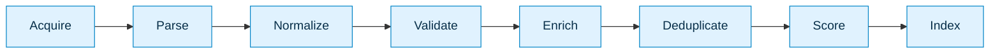
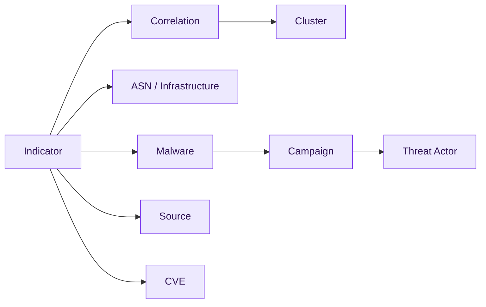
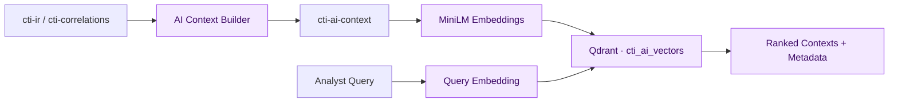
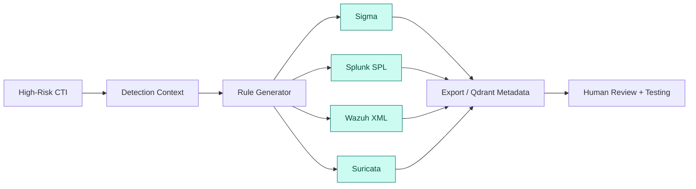

<div align="center">

# SHADOWSCOPE AM

### Cyber Threat Intelligence, Engineered for Investigation and Detection

**An intelligence-driven cybersecurity platform combining large-scale CTI processing, graph analytics, semantic search, local LLM investigation and detection engineering.**

<br>


<br>

**COLLECT** &nbsp;→&nbsp; **NORMALIZE** &nbsp;→&nbsp; **ENRICH** &nbsp;→&nbsp; **CORRELATE** &nbsp;→&nbsp; **INVESTIGATE** &nbsp;→&nbsp; **DETECT**

<br>

[**Overview**](#01--executive-overview) · [**Architecture**](#02--platform-architecture) · [**Engineering**](#03--inside-the-engineering-pipeline) · [**Demonstrations**](#04--technical-demonstrations) · [**Use Cases**](#05--security-operations-use-cases) · [**Roadmap**](#07--engineering-roadmap)

<br>


<sub>ShadowScope AM · Platform architecture</sub>

</div>

---

## 01 — Executive Overview

### From isolated indicators to actionable security intelligence

Threat intelligence is everywhere. Context is not.

An IP address may appear in a reputation feed. A related domain may appear in a phishing dataset. A vulnerability may be flagged by a national CERT. A malware family may be documented in a separate report. An analyst still has to connect the evidence, identify relevant relationships, prioritize an investigation and decide what can actually be detected.

**ShadowScope AM was built to connect those steps.** Rather than treating CTI as a collection of independent indicators, the platform develops a consistent chain from raw external feeds to contextualized records, correlated entities, graph relationships, meaning-based retrieval, investigation support and draft detection rules.

> **Core design principle:** threat intelligence should end in an informed analyst decision or a verifiable detection opportunity—not another disconnected dashboard.

### Platform snapshot

| Acquisition | Investigation | Intelligence modeling | Detection |
|:--:|:--:|:--:|:--:|
| **20/20** collectors successful | **P1 / P2** prioritized CTI | **384-D** semantic vectors | **4** output formats |
| Scheduled collection | Risk-based `cti-ir` queue | OpenSearch + Neo4j + Qdrant | Sigma · Splunk · Wazuh · Suricata |

<sub>Values reflect the captured technical demonstrations, not live production metrics.</sub>

### The platform in four layers

<table>
<tr>
<td width="25%" valign="top"><strong>01 · Intelligence Foundation</strong><br><br>CTI acquisition, raw retention, normalization, source provenance, enrichment, validation and risk scoring.</td>
<td width="25%" valign="top"><strong>02 · Connected Intelligence</strong><br><br>Threat correlation, entity clusters, infrastructure links and Neo4j knowledge graph exploration.</td>
<td width="25%" valign="top"><strong>03 · Contextual Investigation</strong><br><br>Structured and semantic retrieval, Qdrant vectors, local LLM assistance and planned multi-context agent coordination.</td>
<td width="25%" valign="top"><strong>04 · Detection Engineering</strong><br><br>Detection candidate preparation, multi-format rule generation, export and review before operational integration.</td>
</tr>
</table>

### What has been demonstrated

- **Collection and data engineering:** 20 CTI collectors in the recorded run; 85 raw MinIO objects (~436.8 MiB); unified CTI records.
- **Risk-based operations:** enrichment, explainable heuristic validation, risk scores and a dedicated high-priority investigation index.
- **Graph intelligence:** direct IOC investigation, automatic correlation groups and FlowerStorm malware-centric graph exploration.
- **Semantic intelligence:** contextual text generation, 384-dimensional embeddings, Qdrant indexing and natural-language threat search.
- **Investigation assistance:** a FastAPI `/ask` workflow returning semantic contexts and a locally generated assessment, with a known Neo4j connection issue in the captured test.
- **Detection engineering:** generated Sigma, Splunk SPL, Wazuh and Suricata content, indexed with supporting intelligence metadata.

> [!IMPORTANT]
> ShadowScope AM is an **active engineering project**, not a claim of fully autonomous, production-certified cyber defense. The eight demos distinguish observed results from integration work and future capabilities.

---

## 02 — Platform Architecture

### 2.1 End-to-end data flow

```mermaid
flowchart TB
  subgraph S["EXTERNAL INTELLIGENCE"]
    S1["CTI APIs · Feeds · Advisories · Reputation"]
  end
  subgraph I["DATA FOUNDATION"]
    C["Python CTI Collectors"] --> RAW["MinIO · Raw Source Evidence"]
    RAW --> PIPE["Parse · Normalize · Enrich · Validate · Score"]
    PIPE --> GLOBAL["OpenSearch · cti-global"]
  end
  subgraph R["INVESTIGATION & CORRELATION"]
    GLOBAL --> SELECT["Risk-Based Investigation Selection"]
    SELECT --> IR["OpenSearch · cti-ir"]
    IR --> COR["Correlation Engine"]
    COR --> CORIDX["OpenSearch · cti-correlations"]
    CORIDX --> GRAPH["Neo4j · Threat Knowledge Graph"]
  end
  subgraph A["SEMANTIC & LLM CONTEXT"]
    IR --> TEXT["Context Builder"]
    CORIDX --> TEXT
    TEXT --> CTX["OpenSearch · cti-ai-context"]
    CTX --> EMB["MiniLM · 384-D Embeddings"]
    EMB --> VEC["Qdrant · cti_ai_vectors"]
    VEC --> API["FastAPI · Investigation Assistant"]
    IR --> API
    GRAPH -. "Graph integration · test incomplete" .-> API
    API --> LLM["Ollama · Local LLM"]
  end
  subgraph D["DETECTION & REVIEW"]
    IR --> RULES["Detection Engineering"]
    LLM -. "Analyst-reviewed insights" .-> RULES
    RULES --> FMT["Sigma · Splunk · Wazuh · Suricata"]
    RULES --> DQ["Qdrant · cti_detection_vectors"]
    FMT --> REVIEW["Validation · Testing · Analyst Approval"]
  end
  S1 --> C
  classDef source fill:#DBEAFE,stroke:#2563EB,color:#10213D;
  classDef graph fill:#EDE9FE,stroke:#7C3AED,color:#241245;
  classDef action fill:#CCFBF1,stroke:#0F766E,color:#073D37;
  class GLOBAL,IR,CORIDX,RAW,CTX source;
  class GRAPH,EMB,VEC,API,LLM graph;
  class RULES,FMT,DQ,REVIEW action;
```

**Why three intelligence representations?** They answer different questions:

| Representation | System | Primary question | Typical operation |
|---|---|---|---|
| **Structured records** | OpenSearch | *What do we know about this entity?* | IOC lookup, filters, aggregations, risk selection |
| **Explicit relationships** | Neo4j | *How are these entities connected in the data?* | Graph traversal, malware/infrastructure pivots, clusters |
| **Semantic context** | Qdrant | *What other records describe a similar threat concept?* | Natural-language and vector-similarity retrieval |

The LLM-facing layer is designed to consume relevant evidence from these representations rather than depend solely on general model knowledge.

### 2.2 Data stores and responsibilities

| Component | Index / Collection | Stored information |
|---|---|---|
| **MinIO** | `cti/raw/` | Unmodified source payloads and provenance |
| **OpenSearch** | `cti-global` | Unified CTI records |
| **OpenSearch** | `cti-ir` | Risk-selected records and analyst-priority metadata |
| **OpenSearch** | `cti-correlations` | Shared-attribute correlations and cluster IDs |
| **OpenSearch** | `cti-ai-context` | Context text, summaries and original document references |
| **Neo4j** | Threat knowledge graph | Indicator, malware, campaign, ASN, source and cluster relationships |
| **Qdrant** | `cti_ai_vectors` | 384-D vectors and source-linked semantic payloads |
| **Qdrant** | `cti_detection_vectors` | Generated detection records and associated metadata |

### 2.3 Technology stack

<div align="center">


</div>

| Area | Implementation |
|---|---|
| Collectors and pipelines | Python, REST/GraphQL, JSON, CSV, XML, feeds and STIX/TAXII as applicable |
| Enrichment | DNS, reverse DNS, ASN, RDAP, geographic/network context, cloud/CDN identification |
| Search and investigation | OpenSearch indices, structured risk scoring and investigation selection |
| Graph analysis | Neo4j and Cypher |
| Semantic search | Sentence Transformers (`all-MiniLM-L6-v2`), normalized 384-D embeddings, Qdrant cosine similarity |
| Local inference | Ollama and Phi-3 Mini |
| Detection content | Sigma, Splunk SPL, Wazuh XML and Suricata signatures |

---

## 03 — Inside the Engineering Pipeline

### 3.1 Acquisition → normalization → source-traceable CTI

The collector layer handles heterogeneous feeds while preserving the original record. Processing then standardizes relevant attributes: value, entity type, source, confidence, severity, first/last-seen timestamps, malware, threat actors, campaign references, CVEs, infrastructure, tags, descriptions and raw-source references.



**Unified CTI example** — simplified, illustrative structure based on the project's documented fields:

```json
{
  "indicator": "suspicious.example",
  "entity_type": "indicator",
  "risk_score": 95,
  "risk_level": "critical",
  "priority": "P1",
  "validation_status": "malicious",
  "threat_types": ["phishing"],
  "sources": ["threat-intelligence-feed"]
}
```

Fields are populated according to the information available from each source. A missing field does not imply that a particular relationship or threat characteristic has been established.

### 3.2 Threat validation and prioritization

The enrichment/validation layers evaluate multiple signals—including source confidence, malicious or suspicious classifications, infrastructure characteristics and potential false-positive conditions—to produce explainable internal risk indicators.

**Promotion to the investigation queue (`cti-ir`):**

| Policy | Condition |
|---|---|
| Validation | `malicious` or `suspicious` |
| Risk | Score **≥ 70** |
| Priority | **P1** or **P2** |
| Exclusions | Benign shared infrastructure and high false-positive-risk records |
| Persistence | Promoted to `cti-ir`; original remains in `cti-global` |

| Risk score | IR tier | Suggested next step |
|---|---|---|
| **90–100** | Critical / P1 | Immediate investigation |
| **70–89** | High / P2 | Investigation |

The scoring engine produces project-specific assessments. A `100/100` score or a 60% malicious-likelihood estimate should not be confused with a statistically calibrated probability of real-world maliciousness.

### 3.3 Correlation → clusters → knowledge graph

Rather than declaring that all similar IOCs are part of the same operation, the correlation engine stores the **specific shared property** that links them: malware family, threat type, ASN, hosting organization, campaign, source, country, CVE or other available attribute.

A correlation record can include the shared value, entity count, cluster identifier, severity, confidence and risk statistics. Neo4j then exposes those relationships for analysts to inspect.



**Operational distinction:** *linked by an observed attribute* is not equivalent to *proven to be controlled by the same adversary*.

### 3.4 Context engineering → embeddings → semantic search

`06_AI_Assistant/ai_context_builder.py` transforms high-priority intelligence and correlation records into readable textual contexts in `cti-ai-context`. Each text record retains references to its original OpenSearch document.

`06_AI_Assistant/embedding_engine.py` generates **384-dimensional**, normalized sentence embeddings using `sentence-transformers/all-MiniLM-L6-v2` and stores them in Qdrant's `cti_ai_vectors` collection, configured for **cosine similarity**.



A query can describe phishing infrastructure, malware characteristics, or shared network organizations in natural language. Ranking identifies **semantic relevance**; security judgment still depends on the underlying evidence.

### 3.5 Investigation API and local LLM

The documented assistant exposes a FastAPI `/ask` endpoint. It can retrieve relevant semantic CTI contexts and generate a structured analytical answer using a local LLM. The architecture also provides for Neo4j graph retrieval and richer multi-context RAG.

**Investigation request used in Demo 07:**

```http
POST /ask
Content-Type: application/json
```

```json
{
  "question": "What is the risk associated with node828765.dwservice.net?",
  "top_k": 3
}
```

The example test returned three semantic records and a generated assessment, but **Neo4j graph retrieval failed during that execution**. Accordingly, the result demonstrates API execution and response synthesis, not validated graph-grounded attribution. This is part of the engineering work described in the roadmap.

### 3.6 Intelligence → detection engineering

The detection engine converts available IOC and risk metadata into draft content for four different monitoring technologies.

| Format | Payload field | Intended use | Required validation |
|---|---|---|---|
| **Sigma** | `sigma_rule` | Portable SIEM detection logic | Schema, log source, backend conversion |
| **Splunk** | `splunk_query` | SPL searches / threat hunting | Source types, field mappings, search behavior |
| **Wazuh** | `wazuh_rule` | XML-based event detection | XML syntax, decoder and rule compatibility |
| **Suricata** | `suricata_rule` | Network IDS/IPS signature | Protocol visibility, syntax and false positives |

Generated records can be exported to `/opt/cti-detections` and indexed as detection intelligence in `cti_detection_vectors` with IOC references, risk, severity, priority and deployment status.

> **Engineering boundary:** a generated rule is an artifact for review. Its existence is not proof that it will detect an attack correctly in a live SIEM, EDR or IDS deployment.

---

## 04 — Technical Demonstrations

Eight technical demonstrations document the implementation step by step. The full screenshots are deliberately retained below, with exact original filenames, so that readers can inspect the underlying evidence rather than rely on architecture claims alone.

| Demo | Focus | What the captures establish |
|:--:|---|---|
| **01** | Global CTI pipeline | Collection, MinIO storage, normalization and unified schema |
| **02** | Enrichment & risk | Network context, rule-based validation, risk scoring |
| **03** | Investigation queue | Prioritized CTI in a dedicated IR index and dashboard |
| **04** | Correlation & graph | IOC pivots, cluster discovery, malware-centric relationships |
| **05** | Context & vectors | AI-ready CTI text and Qdrant embeddings |
| **06** | Semantic threat search | Natural-language retrieval and ranked correlation contexts |
| **07** | LLM investigation | API request, semantic results, graph integration status and generated answer |
| **08** | Detection engineering | Four rule formats and associated detection record |

### DEMO 01 / Global CTI Acquisition & Unified Data

**Goal:** build a reusable intelligence foundation from heterogeneous external sources.

#### 01.1 — Multi-source CTI collection

<p align="center"></p>

**Captured result:** **20/20 collectors successful.** The documented configuration schedules daily collection across vulnerability, malware, phishing, infrastructure/reputation and additional threat-intelligence sources, with raw outputs sent to MinIO.

#### 01.2 — Raw intelligence preservation

<p align="center"></p>

**Captured result:** **85 objects**, approximately **436.8 MiB**, organized by source in `cti/raw/`. Raw retention supports provenance and potential reprocessing.

#### 01.3 — Source normalization

<p align="center"></p>

**Captured result:** **437 normalized RSS security-news records**, converted from feed-specific input to structured CTI objects.

#### 01.4 — Unified CTI schema

<p align="center"></p>

**Captured example:** **CVE-2010-0249** consolidated with references to intelligence from **CISA KEV** and **NVD**, using standardized severity, confidence, context, source and relationship fields.

**What this demo proves:** acquisition, raw storage and normalization provide a common basis for the later graph, semantic and investigation layers.

---

### DEMO 02 / Context Enrichment, Validation & Scoring

**Goal:** move from normalized IOC records to explainable analyst priorities.

#### 02.1 — Infrastructure enrichment

<p align="center"></p>

The enriched record demonstrates ASN and organization context, DNS/RDAP, geographic/network classifications, cloud/CDN signals, false-positive context and processing timestamps.

#### 02.2 — Rule-based threat validation

<p align="center"></p>

**Captured assessment:** `211.102.140.0/22` → **Suspicious** · **60% heuristic malicious likelihood** · **40 legitimacy score**. The record also includes a validation explanation.

#### 02.3 — Prioritization output

<p align="center"></p>

**Captured assessment:** the same network indicator, with available **PlugX** and **CVE-2010-0249** associations, received **100/100**, **Critical**, **P1** and **Investigate Immediately**.

**What this demo proves:** a contextual intelligence record can carry its own explainable validation and prioritization metadata. These values remain subject to evidence review.

---

### DEMO 03 / Risk-Based Investigation Queue

**Goal:** route high-value CTI to investigation rather than present every collected indicator as an urgent case.

<p align="center"></p>

Records satisfying selection rules are copied from `cti-global` to `cti-ir`. The dashboard exposes P1/P2 intelligence, validation status, risk distribution, malicious/suspicious indicators, related malware/CVE/campaign context and recommended analyst actions.

**What this demo proves:** separation between a broad intelligence knowledge base and a smaller, risk-focused investigation layer.

---

### DEMO 04 / Threat Correlation & Neo4j Knowledge Graph

**Goal:** investigate related security entities through explicit graph relationships and automatically created correlation groups.

#### 04.1 — IOC-centered investigation

**Target:** `node828765.dwservice.net`

```cypher
MATCH (i:Indicator {value: "node828765.dwservice.net"})-[r]-(n)
RETURN i, r, n;
```

<p align="center"></p>

| Captured entities | Count |
|---|---:|
| Nodes / relationships | **107 / 106** |
| Indicators | 1 |
| Malware entities | 16 |
| Correlation nodes | 43 |
| Cluster nodes | 43 |
| ASN, country, source, threat type | 1 each |

A single starting indicator exposed a broad set of connected CTI records for analyst pivoting.

#### 04.2 — Automated correlation clusters

```cypher
MATCH (cl:Cluster)<-[:BELONGS_TO_CLUSTER]-(c:Correlation)
MATCH (i:Indicator)-[:HAS_CORRELATION]->(c)
RETURN cl, c, i
LIMIT 100;
```

<p align="center"></p>

**Captured graph:** **119 nodes**, **93 relationships**, **100 indicators**, **7 correlations** and **7 clusters**. Related attributes also include countries, ASN, source and threat type.

#### 04.3 — Malware-centric pivot: FlowerStorm

```cypher
MATCH (m:Malware {name: "FlowerStorm"})<-[r:ASSOCIATED_WITH_MALWARE]-(i:Indicator)
RETURN m, r, i;
```

<p align="center"></p>

**Captured graph:** **1 malware entity**, **23 associated indicators**, **24 total nodes** and **23 relationships**.

#### 04.4 — Expanded FlowerStorm relationships

<p align="center"></p>

| Captured extended graph | Count |
|---|---:|
| Total nodes | **61** |
| Relationships | **113** |
| Indicators | 23 |
| Correlations / clusters | 16 / 16 |
| ASNs | 2 |

**What this demo proves:** Neo4j can support IOC-centric, correlation-centric and malware-centric investigations. A shared attribute or graph association is an investigation lead, not definitive adversary attribution.

---

### DEMO 05 / Context Engineering & Vector Intelligence

**Goal:** prepare the CTI and correlation layers for semantic analysis and downstream LLM context retrieval.

The **AI Context Builder** processes `cti-ir` and `cti-correlations`, generating source-linked text in `cti-ai-context`. The **Embedding Engine** converts this text using `all-MiniLM-L6-v2` (384 dimensions, normalized vectors) and stores the results in `cti_ai_vectors` using cosine similarity.

#### 05.1 — Qdrant vectorized CTI record

<p align="center"></p>

The screenshot shows a phishing-URL `indicator_context` from `cti-ir` with **100 risk score**, **Critical**, **P1**, **Malicious** validation and `phishing-url` / `phishtank` tags. Source references and processing metadata remain available with the vector payload.

**What this demo proves:** source-linked intelligence can be stored as semantic vectors. This capture validates vector persistence, not semantic retrieval quality on its own.

---

### DEMO 06 / AI-Powered Semantic Threat Search

**Goal:** retrieve conceptually related CTI context without requiring analysts to know exact indicators.

**Query executed:**

```text
Find high-risk indicators sharing ASN infrastructure or threat correlation clusters.
```

| Search setting | Value |
|---|---|
| Top K | **10** |
| Minimum similarity | **0.30** |
| Search type | Natural-language embedding + Qdrant cosine similarity |

#### 06.1 — Query and ranked results

<p align="center"></p>

The retrieved records are primarily `correlation_context` entries for `shared_asn_org`. Displayed similarity values are approximately **0.64–0.67**, with **Critical**, **P1**, **100 risk score** and associated correlation/cluster metadata.

#### 06.2 — Extended result set

<p align="center"></p>

Returned descriptions reference organizations including VNET a.s., TIMENET SPA, Metronet, FranTech Solutions, Baxet Group Inc., Awarenes Software Limited and SECURED SERVERS LLC. These are values appearing in the retrieved dataset: their appearance does **not** establish wrongdoing or malicious control by the organizations.

#### Video scenario slots

The following three walkthroughs are reserved for future video publication. Links are intentionally not invented.

| Scenario | Search prompt | Recording |
|---|---|---|
| **Phishing intelligence** | `Find high-risk phishing URLs reported by PhishTank.` | To be added |
| **Malware intelligence** | `Find threat intelligence related to FlowerStorm malware and associated indicators.` | To be added |
| **Infrastructure & correlation** | `Find high-risk indicators sharing ASN infrastructure or threat correlation clusters.` | To be added |

**What this demo proves:** the deployed semantic search path returned relevant risk-aware CTI correlation contexts to a natural-language question. Similarity alone does not establish causality.

---

### DEMO 07 / CTI LLM Assistant & Threat Investigation

**Goal:** use locally generated language-model output to summarize retrieved intelligence in an analyst-friendly investigation format.

#### 07.1 — Investigation request through FastAPI

```json
{
  "question": "What is the risk associated with node828765.dwservice.net?",
  "top_k": 3
}
```

<p align="center"></p>

The analyst submitted the question to `POST /ask` using the Swagger/OpenAPI interface.

#### 07.2 — Semantic contexts returned

<p align="center"></p>

**HTTP 200** was returned, along with the following semantic search results:

| Retrieved IOC | Similarity | Risk | Priority | Source |
|---|---:|---:|---|---|
| `66.232.15.73` | 0.4626 | 90 | P1 | AbuseIPDB |
| `40.127.67.83` | 0.4612 | 78 | P2 | AbuseIPDB |
| `31.14.32.7` | 0.4588 | 90 | P1 | AbuseIPDB |

The returned IP contexts were relevant to the vector search, but **did not independently prove a relationship to the domain under investigation**.

#### 07.3 — Knowledge graph retrieval status

<p align="center"></p>

The Neo4j connection failed in the captured execution. Semantic retrieval succeeded, but the graph context was unavailable. This means the test does **not** establish end-to-end graph-augmented RAG.

#### 07.4 — Generated threat assessment

<p align="center"></p>

The assistant produced an executive summary, threat classification, risk explanation and related-intelligence discussion. Some associations expressed in the generated text require checking against direct IOC matches and the original source evidence.

| Component | Captured status |
|---|---|
| `POST /ask` API | **Operational — HTTP 200** |
| Qdrant semantic retrieval | **Operational** |
| CTI context and risk metadata | **Returned** |
| Local LLM synthesis | **Generated** |
| Neo4j retrieval in this API run | **Connection failed** |
| Evidence-grounded attribution | **Not validated** |
| Autonomous multi-agent investigation | **Not established** |

**What this demo proves:** an analyst can submit a question, retrieve semantic intelligence and receive a structured local LLM response. Stronger evidence checks and restored graph integration are necessary before relying on the output for operational attribution.

---

### DEMO 08 / Automated Multi-Format Detection Engineering

**Goal:** prepare detection content directly from prioritized CTI rather than stop the workflow at investigation.



#### 08.1 — Generated detection intelligence record

<p align="center"></p>

| Captured attribute | Value |
|---|---|
| Collection | `cti_detection_vectors` |
| Indicator type | URL |
| Format | Multi |
| Risk | **100/100** |
| Severity / Priority | **Critical / P1** |
| SOC action | Investigate |
| Deployment state | **Generated** |
| Export location | `/opt/cti-detections` |

The record includes `sigma_rule`, `splunk_query`, `wazuh_rule` and `suricata_rule`, together with detection metadata, original indicator, timestamps and export path.

**What this demo proves:** detection content is generated in four formats and stored with traceable intelligence metadata. Testing against target platforms, checking accuracy and false positives, and production deployment are separate steps.

---

## 05 — Security Operations Use Cases

### A practical bridge between threat intelligence and defensive operations

| Team | Starting point | What the platform helps prepare |
|---|---|---|
| **SOC / Tier 1–2** | Alert with suspicious indicator | Prioritized CTI context, validation status, related records |
| **CTI analyst** | Fragmented provider feeds | Unified records, source references, correlation groups |
| **Threat hunter** | Behavior or infrastructure hypothesis | Natural-language search results and graph investigation paths |
| **Incident responder** | IOC, malware family or suspicious infrastructure | Entity relationships, potential pivots and contextual evidence |
| **Detection engineer** | High-risk CTI candidate | Draft Sigma/SPL/Wazuh/Suricata content for testing |
| **Security architect** | Multiple disconnected tools | A reference architecture linking structured, graph and vector intelligence |

### Example: from suspicious domain to investigation context

1. A domain arrives in one or more external CTI feeds and is preserved with source provenance.
2. Normalization and enrichment add available threat, network and source context.
3. Validation and risk-scoring logic determine whether the entity is selected for `cti-ir`.
4. Correlation/Neo4j exposes recorded malware, infrastructure or cluster associations.
5. Semantic search retrieves additional descriptions that may help contextualize the case.
6. The analyst reviews original evidence, separates confirmed relationships from semantic suggestions, and decides whether detection content should be prepared.
7. Generated rules undergo environment-specific review and testing before operational integration.

**Value proposition:** fewer disconnected investigation steps and a more consistent path from intelligence retrieval to analyst-reviewed detection preparation. Time savings and detection-quality improvements still require benchmark studies.

### How an organization can evaluate the platform

A useful technical evaluation should be based on a **defined CTI dataset, explicit success criteria and reviewable outputs**, rather than a polished demo alone.

| Evaluation track | Questions to test | Evidence to collect |
|---|---|---|
| **Ingestion & provenance** | Which feeds complete? Can records be traced back to their source? | Collector logs, raw objects, normalized documents |
| **Prioritization** | Why was a record marked P1/P2? How often are benign assets escalated? | Scoring explanations, labeled review samples |
| **Correlation / Neo4j** | Are shared attributes real? Are inferred links clearly differentiated? | Cypher queries, source-backed entity relationships |
| **Semantic search** | Are relevant CTI descriptions retrieved for analyst questions? | Test-query set, ranked results, relevance judgments |
| **Investigation assistant** | Does each claim correspond to retrieved evidence? Does it handle missing graph context? | API traces, context IDs, audited reports |
| **Detection engineering** | Are generated rules syntactically valid and useful on target telemetry? | Engine tests, sample events, false-positive analysis |

This evaluation model also defines a realistic path toward pilot integrations: connect a limited data source, run repeatable investigations, review the evidence and validate selected detections in a controlled environment.

---

## 06 — Validation & Technical Boundaries

The platform is presented with a distinction between what has been **captured in technical execution** and what remains an **engineering objective**.

| Capability | Evidence | Status |
|---|---|---|
| CTI acquisition, storage, normalization | Demo 01 screenshots | **Demonstrated** |
| Enrichment, heuristic validation, risk scoring | Demo 02 screenshots | **Demonstrated** |
| Investigation-index selection and dashboard | Demo 03 screenshot | **Demonstrated** |
| Neo4j graph queries, correlations, malware associations | Demo 04 screenshots | **Demonstrated** |
| CTI context embedding and vector persistence | Demo 05 screenshot | **Demonstrated** |
| Natural-language semantic search | Demo 06 screenshots | **Demonstrated** |
| FastAPI + semantic retrieval + LLM-generated answer | Demo 07 screenshots | **Demonstrated with limitations** |
| Neo4j context inside captured LLM execution | Demo 07 connection error | **Not validated in this run** |
| Four detection output formats, record storage | Demo 08 screenshot | **Demonstrated** |
| Detection accuracy, production integration, autonomous response | No corresponding evidence in supplied demos | **Not established** |

> [!NOTE]
> The demonstrations are engineering snapshots. No claims are made here about independently measured SOC time reductions, production-scale ingestion throughput, confirmed attribution accuracy, or fully automated defense actions.

### Responsible security operation

- **Provenance:** retain original intelligence references so analysts can inspect the source behind each result.
- **Evidence separation:** exact IOC matches, graph associations and semantic similarity represent different levels of evidence.
- **Human approval:** generated assessments and detection rules remain subject to expert review.
- **Local inference:** Ollama can keep LLM processing on controlled infrastructure, subject to proper access and system security controls.
- **Reproducibility:** test runs, source availability, configuration and dataset state affect outputs; documented snapshots are not guaranteed future results.
- **Public-release hygiene:** remove credentials, nonpublic API details, sensitive indicators and internal deployment information from code and screenshots before publication.

---

## 07 — Engineering Roadmap

| Priority area | Next steps | Desired outcome |
|---|---|---|
| **Intelligence quality** | More CTI sources, provenance checks, temporal enrichment, confidence calibration | More reliable entity records and prioritization |
| **Threat graph** | Richer entity resolution, multi-hop exploration, time-aware infrastructure analysis | Stronger relationship investigations |
| **Search & retrieval** | Hybrid search, reranking, retrieval benchmarks, improved query interpretation | Higher relevance and fewer misleading matches |
| **LLM / RAG** | Restore Neo4j connectivity, exact IOC first, citation-backed answers, evidence checks | Safer and more defensible investigations |
| **Agent orchestration** | Permissioned specialist tools, explicit workflows, audit trails, human approval gates | Controlled multi-step analyst assistance |
| **Detection quality** | Syntax validation, log mapping, ATT&CK context, test datasets, false-positive analysis | Detection content suitable for platform-specific testing |
| **Operational maturity** | CI tests, monitoring, configuration management, secrets handling, deployment documentation | More reproducible deployments and evaluations |

### Long-term direction

ShadowScope AM is designed to evolve toward a **continuous, feedback-driven defense engineering loop**: ingest external intelligence, identify relevant threats, investigate with structured and contextual evidence, prepare validated detections, and use confirmed results to refine future analysis. Agentic workflows are a direction for supervised automation—not a substitute for security controls and human accountability.

---

## 08 — Repository Notes & Demonstration Assets

The README uses standard GitHub Markdown, HTML image tags, Mermaid diagrams and Shields badges. No custom CSS, hosted application or proprietary GitHub theme is required.

**All 21 original image references are preserved**, including the architecture diagram and screenshots for Demos 01–08. To render them, place those PNGs in the same directory as `README.md`, or adjust the relative paths after moving them. The original filename `demo01-01-multi-source-cti-acquisition.png.png` has deliberately been retained.

This document describes the platform and recorded technical results. Public installation commands, deployment scripts, environment variables and source-code licensing should be documented according to the files actually published in the repository; they are not fabricated here.

---

## 09 — Project Vision & Conclusion

I built **ShadowScope AM** around a recurring cybersecurity problem: collecting threat intelligence is comparatively easy; making it consistent, explainable and useful during real investigations is much harder.

The project now connects several engineering disciplines that are often treated separately: **data pipelines, CTI normalization, contextual enrichment, risk prioritization, correlation graphs, semantic embeddings, locally hosted language models and detection-rule generation**. The eight demonstrations show the path from external sources to practical outputs, as well as the integration work required to make those outputs more dependable.

The next milestone is not simply adding more feeds or another model. It is strengthening the trustworthiness of the chain: accurate entity resolution, evidence-grounded investigation, reliable graph/context fusion, measurable retrieval quality and validated detections for specific security platforms.

**The ambition is an intelligence-to-defense platform in which every retrieved indicator has context, every relationship can be examined, every recommendation can be checked, and every detection can be tested.**

<div align="center">

---

### SHADOWSCOPE AM

**GLOBAL INTELLIGENCE. CONNECTED THREATS. ACTIONABLE DEFENSE.**

*From fragmented threat data to evidence-driven investigation and detection.*

<br>

**Amine Maouhoub**  
Cybersecurity Engineer · M2 Cybersecurity Management  
Cyber Threat Intelligence · Knowledge Graphs · AI Security · Threat Hunting · Detection Engineering

<br>


</div>
