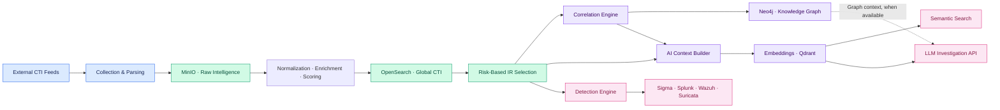
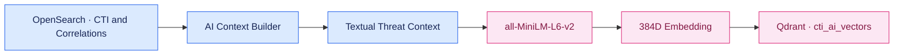
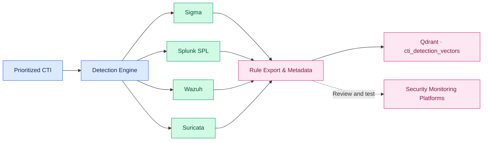

<div align="center">

# 🛡️ SHADOWSCOPE AM

### Cyber Threat Intelligence · Graph Intelligence · Semantic Threat Hunting · Detection Engineering

**An intelligence-driven cybersecurity platform built to connect fragmented threat data with practical security investigations and detection workflows.**

<p>
  
  
  
</p>
<p>
  
  
  
  
  
</p>

**Global Intelligence · Connected Threats · Contextual Investigation · Proactive Detection**

[Overview](#overview) · [Architecture](#architecture) · [Capabilities](#core-capabilities) · [Technical Demos](#technical-demonstrations) · [Technology](#technology-stack) · [Roadmap](#roadmap) · [Conclusion](#conclusion)

</div>

---

## Overview

Cyber Threat Intelligence is abundant, but operational context is often fragmented. Security teams work across different feeds, formats, tools and consoles, while the relationships between indicators, infrastructure, malware and campaigns remain difficult to reconstruct.

I developed **ShadowScope AM** to bring those intelligence layers into a single technical workflow: collect external threat data, normalize and enrich it, select relevant investigation candidates, uncover shared relationships, retrieve contextual intelligence and prepare detection content.

The project connects **OpenSearch, Neo4j, Qdrant, Python and local language-model components** to explore a practical question:

> **How can global threat intelligence become connected, searchable and actionable for security operations?**

The platform currently demonstrates working components for multi-source collection, CTI processing, risk-based investigation selection, correlation graphs, semantic vector retrieval, an LLM-assisted API and generation of detection content in four formats. Some advanced integrations, notably evidence-verified LLM conclusions and production detection deployment, remain under development.

### Project at a glance

| Area | Implementation |
|---|---|
| Intelligence acquisition | 20 collectors tested across multiple CTI categories |
| Raw data layer | MinIO object storage |
| Search and investigation | OpenSearch: `cti-global`, `cti-ir`, `cti-correlations`, `cti-ai-context` |
| Threat relationships | Neo4j Knowledge Graph |
| Semantic intelligence | Qdrant + `all-MiniLM-L6-v2` embeddings |
| Investigation interface | Semantic Search UI and FastAPI CTI LLM Assistant |
| Detection content | Sigma, Splunk SPL, Wazuh and Suricata |
| Operating approach | Risk-based prioritization and analyst-controlled validation |

---

## Architecture

<p align="center">
  
</p>

The architecture separates raw intelligence, normalized search records, correlation relationships and vectorized context. This allows each component to serve a distinct investigative purpose without forcing every query through a single storage or processing model.



### Intelligence lifecycle

**Collect → Normalize → Enrich → Validate → Score → Investigate → Correlate → Retrieve → Detect**

The system is designed around a feedback loop in which threat intelligence informs investigation and detection, while future security observations can enrich subsequent investigations. Operationally closing that loop is part of the continuing roadmap.

---

## Core Capabilities

### 01 · Multi-source CTI acquisition

Python collectors ingest vulnerability data, malicious infrastructure intelligence, malware and phishing feeds, reputation information and other security sources. Original records are preserved in MinIO so they can be inspected or reprocessed independently of downstream schemas.

### 02 · Unified processing and enrichment

Incoming records are parsed, normalized and indexed using a common CTI representation. Where available, the enrichment layer adds DNS, RDAP, ASN, network organization, country and infrastructure classification details while retaining source provenance.

### 03 · Validation, scoring and investigation selection

A rule-based validation stage evaluates threat-related attributes and potential false-positive context. Risk scoring assigns an operational score and priority. High-priority investigation candidates are copied into `cti-ir`, separating analyst-focused intelligence from the full global dataset.

### 04 · Correlation and Knowledge Graph

The correlation engine groups records by shared attributes including ASN, malware family, campaigns, APT references, CVEs, sources and other relevant context. Neo4j records explicit connections among indicators, malware, infrastructure, correlation entities and clusters. Shared attributes are **investigative leads**, not proof of common threat-actor ownership.

### 05 · Vector intelligence and semantic retrieval

Structured investigation and correlation records are transformed into descriptive text, embedded with a 384-dimensional Sentence Transformer and stored in Qdrant. Analysts can search by intent or context instead of relying exclusively on exact IOC values.

### 06 · LLM-assisted investigation

The FastAPI assistant retrieves CTI context and produces structured natural-language assessments using a local model. Semantic retrieval has been demonstrated; complete graph-enriched reasoning and evidence-grounded attribution still require further validation.

### 07 · Detection engineering

A detection engine generates Sigma, Splunk SPL, Wazuh and Suricata content based on selected threat indicators. Generated records are exported and indexed for subsequent review. Rule generation is distinct from syntax validation, false-positive testing and live deployment.

---

## Repository Components

The main processing modules are organized by their role in the CTI lifecycle:

```text
Source_Code/
├── 01_Data_Collection/
├── 02_Data_Normalization/
├── 03_Indexing_Search/
├── 04_Threat_Enrichment/
├── 05_Correlation_Knowledge_Graph/
│   ├── correlation_engine.py
│   └── graph_loader.py
├── 06_AI_Assistant/
│   ├── ai_context_builder.py
│   ├── embedding_engine.py
│   ├── semantic_search_api.py
│   ├── llm_assistant_api.py
│   ├── ai_classification_engine.py
│   └── detection_engine.py
└── 07_Documentation/
```

The repository may also contain service configurations, interfaces, deployment files and experimental components associated with these modules. Credentials and environment-specific configuration must be kept outside the public source tree.

---

## Technical Demonstrations

The following eight demonstrations trace the implemented intelligence workflow, with screenshots captured from the running components and their interfaces. Counts and scores are snapshots from the recorded executions, not fixed system-wide benchmarks.

| Demo | Focus | Evidence |
|---|---|---|
| [01](#demo-01--global-cti-pipeline) | Collection and normalization | Collectors, MinIO, normalized records, CTI schema |
| [02](#demo-02--threat-enrichment-validation--risk-scoring) | Context and prioritization | Enrichment, validation, scoring |
| [03](#demo-03--risk-based-cti-investigation-queue) | Investigation selection | IR dashboard |
| [04](#demo-04--threat-correlation--knowledge-graph) | Graph-based intelligence | IOC, clusters, FlowerStorm |
| [05](#demo-05--ai-contexts--vector-intelligence) | Text and embeddings | Qdrant vector payload |
| [06](#demo-06--semantic-threat-search) | Natural-language search | Ranked correlation contexts |
| [07](#demo-07--cti-llm-assistant) | LLM-assisted investigation | FastAPI request and response |
| [08](#demo-08--automated-detection-engineering) | Detection generation | Four rule formats indexed in Qdrant |

### Demo 01 · Global CTI Pipeline

The collection pipeline transforms heterogeneous external intelligence into structured records suitable for downstream analysis. In the recorded run, **20 out of 20 CTI collectors completed their tests successfully**, and the MinIO raw layer contained **85 objects totaling approximately 436.8 MiB**.

#### Capture 01 — Multi-source acquisition

<p align="center"></p>

The collectors cover multiple intelligence domains, including vulnerabilities, phishing, malware and infrastructure information. Collection is configured for scheduled execution; each run feeds the raw intelligence layer.

**Observed:** `20/20 collectors successful` · `Scheduled acquisition` · `Raw data preserved`

#### Capture 02 — Raw intelligence storage

<p align="center"></p>

The source-specific objects remain available for traceability and future reprocessing.

**Observed:** `85 objects` · `~436.8 MiB` · `MinIO`

#### Capture 03 — Record normalization

<p align="center"></p>

A recorded RSS normalization run produced **437 structured security-news records**, illustrating the conversion of feed-specific content into a consistent format.

#### Capture 04 — Unified CTI schema

<p align="center"></p>

The example uses `CVE-2010-0249` to show common fields for identity, source provenance, risk, related entities and references. The same approach supports the search, enrichment and investigation layers.

**Outcome:** One processing foundation for multiple CTI sources and data types.

---

### Demo 02 · Threat Enrichment, Validation & Risk Scoring

This stage adds context to normalized intelligence, evaluates the available evidence and assigns an operational priority before investigation selection.

#### Capture 01 — Infrastructure enrichment

<p align="center"></p>

The enrichment output includes supported DNS, ASN, RDAP and network-classification attributes. These details are important when distinguishing malicious indicators from shared, legitimate or otherwise ambiguous infrastructure.

#### Capture 02 — Rule-based validation

<p align="center"></p>

The record `211.102.140.0/22` is classified **Suspicious**, with a reported **60% malicious likelihood** and **40 legitimacy score** under the platform's rule-based assessment. These are model outputs, not independently measured probabilities.

#### Capture 03 — Risk scoring and priority

<p align="center"></p>

The captured intelligence record is associated with PlugX and `CVE-2010-0249`, and receives a **100/100 risk score**, **Critical** severity and **P1** investigation priority in the recorded execution.

**Outcome:** Enriched intelligence with an explainable score and an actionable investigation priority.

---

### Demo 03 · Risk-Based CTI Investigation Queue

Only a subset of globally collected intelligence should require analyst attention. The investigation selection stage promotes eligible high-risk records to `cti-ir`, leaving the global CTI index available for broader searching and analytics.

The selection criteria documented for the IR workflow include completed scoring, suspicious or malicious validation, **risk score ≥ 70**, P1/P2 priority and exclusion of known benign or high false-positive-risk shared infrastructure.

| Score | Operational level | Next step |
|---|---|---|
| 90–100 | Critical / P1 | Immediate investigation |
| 70–89 | High / P2 | Analyst investigation |

#### Capture 01 — Investigation dashboard

<p align="center"></p>

The dashboard consolidates severity, priority, investigation candidates, validation results, malware, vulnerabilities and threat classifications. It is designed to give a SOC or CTI analyst a focused queue rather than an undifferentiated feed of indicators.

**Outcome:** `cti-global` → selected `cti-ir` investigation candidates.

---

### Demo 04 · Threat Correlation & Knowledge Graph

The correlation engine operates on prioritized CTI, identifying groups of records sharing attributes such as ASN organization, malware families, threat categories, campaign references and source context. Neo4j then exposes their relationships through graph queries.

**Data model:** `Indicator` · `Malware` · `ASN` · `Country` · `Source` · `ThreatType` · `Correlation` · `Cluster` · `Campaign` · `APT` · `CVE`

#### Capture 01 — IOC relationship investigation

**Target:** `node828765.dwservice.net`

```cypher
MATCH (i:Indicator {value: "node828765.dwservice.net"})-[r]-(n)
RETURN i, r, n;
```

<p align="center"></p>

| Captured graph | Result |
|---|---:|
| Nodes / relationships | 107 / 106 |
| Malware nodes | 16 |
| Correlation nodes | 43 |
| Cluster nodes | 43 |

An IOC-centric query reveals explicit records connected to one domain. The graph is a navigable intelligence map, not automatic proof that every connected record is part of the same intrusion.

#### Capture 02 — Correlation and cluster exploration

```cypher
MATCH (cl:Cluster)<-[:BELONGS_TO_CLUSTER]-(c:Correlation)
MATCH (i:Indicator)-[:HAS_CORRELATION]->(c)
RETURN cl, c, i
LIMIT 100;
```

<p align="center"></p>

The captured result contains **119 nodes**, including **100 indicators, 7 correlations and 7 clusters**, and **93 displayed relationships**. Graph visualization can also show disconnected nodes when the result or browser expansion includes other contextual entities.

#### Capture 03 — FlowerStorm malware associations

```cypher
MATCH (m:Malware {name: "FlowerStorm"})<-[r:ASSOCIATED_WITH_MALWARE]-(i:Indicator)
RETURN m, r, i;
```

<p align="center"></p>

**Observed:** `1 FlowerStorm node` · `23 indicators` · `23 associations`

#### Capture 04 — Expanded FlowerStorm context

<p align="center"></p>

The extended graph displays **61 nodes** and **113 relationships**, including indicator, correlation, cluster and infrastructure context. This deeper view supports multi-step pivots from a malware family to associated observables.

**Outcome:** Connected CTI records supporting IOC pivoting, malware investigation and correlation-led threat hunting.

---

### Demo 05 · AI Contexts & Vector Intelligence

The AI context builder constructs descriptive text from `cti-ir` indicators and `cti-correlations` records, combining attributes such as risk, classification, sources, malware, infrastructure and correlation references.

The text is embedded using **`sentence-transformers/all-MiniLM-L6-v2`**, producing **384-dimensional normalized vectors** for Qdrant cosine similarity search.



#### Capture 01 — Qdrant CTI vector payload

<p align="center"></p>

The displayed `cti_ai_vectors` point describes a **PhishTank phishing-URL context**, with **risk score 100**, **Critical** severity, **P1** priority and source metadata. Its `cluster_id` and `correlation_id` fields are null in this captured record.

| Configuration | Value |
|---|---|
| Embedding model | `all-MiniLM-L6-v2` |
| Vector size | 384 |
| Similarity metric | Cosine |
| Collection | `cti_ai_vectors` |
| Context store | OpenSearch `cti-ai-context` |

**Outcome:** Threat intelligence represented as searchable vectors with references back to its structured context.

---

### Demo 06 · Semantic Threat Search

The Semantic Search interface embeds an analyst's natural-language query and retrieves the most similar contexts from Qdrant. Results include similarity scores alongside the source CTI metadata, such as risk, priority, correlation type and cluster identifiers.

**Recorded query:**

```text
Find high-risk indicators sharing ASN infrastructure or threat correlation clusters.
```

**Parameters:** `Top K: 10` · `Minimum similarity: 0.30`

#### Capture 01 — Query and highest-ranked results

<p align="center"></p>

The captured results include `correlation_context` records with `shared_asn_org` types, **P1** priority and **100/100** risk in their source metadata. The highest observed similarity is **0.6715**.

#### Capture 02 — Additional correlation contexts

<p align="center"></p>

The additional results include shared ASN organization contexts for network operators in Europe and North America, with captured similarity values down to approximately **0.6360** among the displayed top ten.

**Interpretation:** Similarity is a retrieval relevance score, not a maliciousness probability or a verified relationship between every retrieved indicator. The explicit correlation details must still be checked in OpenSearch or Neo4j.

#### Video demonstrations

Three walkthroughs are planned for the Semantic Search interface. Each will include its query, retrieval settings, result interpretation and the underlying CTI context.

| Scenario | Analyst query | Video |
|---|---|---|
| 01 · Phishing | `Find high-risk phishing URLs reported by PhishTank.` | *Recording to be added* |
| 02 · Malware | `Find threat intelligence related to FlowerStorm malware and associated indicators.` | *Recording to be added* |
| 03 · Correlation | `Find high-risk indicators sharing ASN infrastructure or threat correlation clusters.` | *Recording to be added* |

**Outcome:** Natural-language retrieval over both indicator and correlation context, with analyst-visible similarity and risk metadata.

---

### Demo 07 · CTI LLM Assistant

A FastAPI endpoint exposes natural-language CTI investigation. The assistant retrieves semantic context and attempts graph enrichment before assembling context for the locally hosted LLM.

The recorded test demonstrates an API response and generated assessment, while also revealing the importance of exact IOC matching and graph connectivity for reliable conclusions.

#### Capture 01 — Investigation request

```http
POST /ask
Content-Type: application/json
```

```json
{
  "question": "What is the risk associated with node828765.dwservice.net?",
  "top_k": 3
}
```

<p align="center"></p>

#### Capture 02 — Retrieved semantic context

<p align="center"></p>

The endpoint returned **HTTP 200** and three semantic context records:

| Indicator | Similarity | Risk | Priority |
|---|---:|---:|---|
| `66.232.15.73` | 0.4626 | 90 | P1 |
| `40.127.67.83` | 0.4612 | 78 | P2 |
| `31.14.32.7` | 0.4588 | 90 | P1 |

These IPs were retrieved as semantically relevant contexts; the response does **not** establish that they are infrastructure controlled by, or directly connected to, the domain in the question.

#### Capture 03 — Graph retrieval status

<p align="center"></p>

The Neo4j connection was unavailable during this particular API test, so graph relationships were not included in the retrieved evidence. The service still returned a response based on available semantic context.

#### Capture 04 — Generated security assessment

<p align="center"></p>

The assistant generated an executive summary, threat classification, risk explanation and related-indicator discussion. Because the graph lookup failed and the retrieved IPs were not exact evidence for the requested domain, the generated associations require analyst verification.

| Function | Recorded status |
|---|---|
| API request and HTTP response | Working |
| Semantic context retrieval | Working |
| Generated investigation narrative | Observed |
| Neo4j enrichment in this test | Connection failed |
| Verified attribution for the queried domain | Not established |

**Outcome:** An operational investigation API prototype and a clear path toward evidence-grounded, graph-enriched assessments.

---

### Demo 08 · Automated Detection Engineering

The detection engine converts selected threat intelligence into draft detection content across **Sigma, Splunk SPL, Wazuh and Suricata**, retaining the source indicator and relevant investigation metadata.

The process separates content generation, export and indexing from the later stages of testing and deployment.



#### Capture 01 — Four-format detection record

<p align="center"></p>

The captured record in **`cti_detection_vectors`** concerns a URL indicator, with **100/100** risk score, **Critical** severity, **P1** priority, action `investigate` and deployment status `generated`. Its payload contains all four output fields:

| Output | Field | Target |
|---|---|---|
| Sigma | `sigma_rule` | Portable SIEM detection logic |
| Splunk | `splunk_query` | SPL investigation and hunting queries |
| Wazuh | `wazuh_rule` | XML-based event detection |
| Suricata | `suricata_rule` | IDS/IPS network signatures |

The record also stores rule identification, source indicator, timestamps and export-path metadata. The screenshot confirms generation and indexing; it does not demonstrate that the rules were tested against event data or deployed to a production sensor or SIEM.

**Outcome:** A repeatable starting point for analyst-reviewed, multi-platform detection engineering.

---

## Technology Stack

| Layer | Technology | Role |
|---|---|---|
| Collection and processing | Python, REST APIs, JSON, CSV, XML, feeds, STIX/TAXII | Acquisition and normalization |
| Raw storage | MinIO | Preservation of original source data |
| Search and analytics | OpenSearch | Unified CTI, investigation and correlation records |
| Graph intelligence | Neo4j | Explicit entity relationships and graph queries |
| Embeddings | Sentence Transformers, `all-MiniLM-L6-v2` | 384D semantic representations |
| Vector intelligence | Qdrant | Semantic CTI and detection-record storage |
| Investigation services | Python, FastAPI | Semantic search and investigation API |
| Local inference | Ollama, Phi-3 Mini | LLM-based context interpretation |
| Detection engineering | Sigma, Splunk SPL, Wazuh, Suricata | Multi-format rule generation |

---

## Validation & Engineering Notes

ShadowScope AM is an engineering project in active development. The eight demonstrations show individual components and integrations at specific moments in time; they are not claims of production readiness or independent detection effectiveness.

| Capability | Evidence in this repository | Current interpretation |
|---|---|---|
| Multi-source CTI processing | Collector and storage screenshots | Successfully demonstrated |
| Threat enrichment and scoring | OpenSearch record screenshots | Successfully demonstrated for the captured records |
| IR investigation selection | Dashboard snapshot | Implemented investigation layer |
| Correlation and Neo4j graph | Neo4j queries and graph screenshots | Graph-based relationships demonstrated |
| Text-to-vector pipeline | Qdrant metadata | Vector creation and storage demonstrated |
| Semantic retrieval | Search UI screenshots | Ranked context retrieval demonstrated |
| LLM investigation | FastAPI response screenshots | Retrieval and response observed; grounding incomplete |
| Detection generation | Qdrant detection payload | Four output formats generated; deployment unverified |

**Interpretation principles:** A correlation is not an attribution. A semantic similarity score is not a threat probability. A generated LLM response is not evidence by itself. A generated detection rule is not an active detection until it has passed syntax, environment and behavioral validation.

### Public repository security

Public code and screenshots should not expose credentials, API tokens, private network details, personal data or unsafe clickable threat URLs. Environment-specific secrets should be stored outside version control. The Swagger screenshot showing a private service address should be redacted before publishing its PNG file; the Markdown image reference can remain unchanged.

Do not deploy generated detection content without review. Validate rule syntax, field mappings, data-source coverage, expected matches and false-positive behavior using appropriate test data.

---

## Roadmap

| Focus | Next engineering step |
|---|---|
| CTI quality | Incremental ingestion, provenance controls, deduplication improvements and freshness handling |
| Correlation | Stronger evidence weighting, temporal relationships and cluster explanations |
| Knowledge Graph | Expanded graph pivots, relationship quality and resilient graph retrieval |
| Semantic Search | Hybrid lexical/vector retrieval, filtering, ranking evaluation and result traceability |
| LLM investigation | Exact IOC lookup, source citations, unavailable-source handling and grounded answer checks |
| Detection Engineering | Syntax tests, replay validation, deduplication, coverage assessment and controlled deployment |
| Operations | Metrics, error handling, observability and repeatable deployment |
| Agentic workflows | Bounded task planning, tool permissions, approval checkpoints and auditable execution |

---

## Conclusion

**ShadowScope AM started from a simple observation: collecting more threat indicators is not the same as understanding more threats.**

A meaningful CTI platform needs to preserve where intelligence comes from, enrich what is known, connect related records and make that context usable in an analyst's workflow. This project follows that path—from multi-source collection and normalized records to investigation queues, correlation graphs, semantic retrieval, LLM-assisted interpretation and multi-format detection content.

The technical demonstrations show the progress of that integration. They also identify the work that matters next: stronger evidence validation, more reliable graph-enriched investigation, measurable semantic retrieval quality and detection rules that can be tested before deployment.

The long-term direction is an **intelligence-driven security platform in which collection, investigation and detection reinforce each other**, with automation reducing repetitive work and security analysts retaining control over high-impact decisions.

> **The goal is not simply to know that a threat exists. It is to understand its context, investigate its connections and turn relevant intelligence into defensible security action.**

---

<div align="center">

### Developed by Amine Maouhoub

**Cybersecurity Engineer · M2 Cybersecurity Manager**

Cyber Threat Intelligence · Threat Hunting · Graph Intelligence · Security Automation · Detection Engineering

**SHADOWSCOPE AM**

*Global Intelligence. Connected Threats. Contextual Investigation. Proactive Defense.*

</div>
